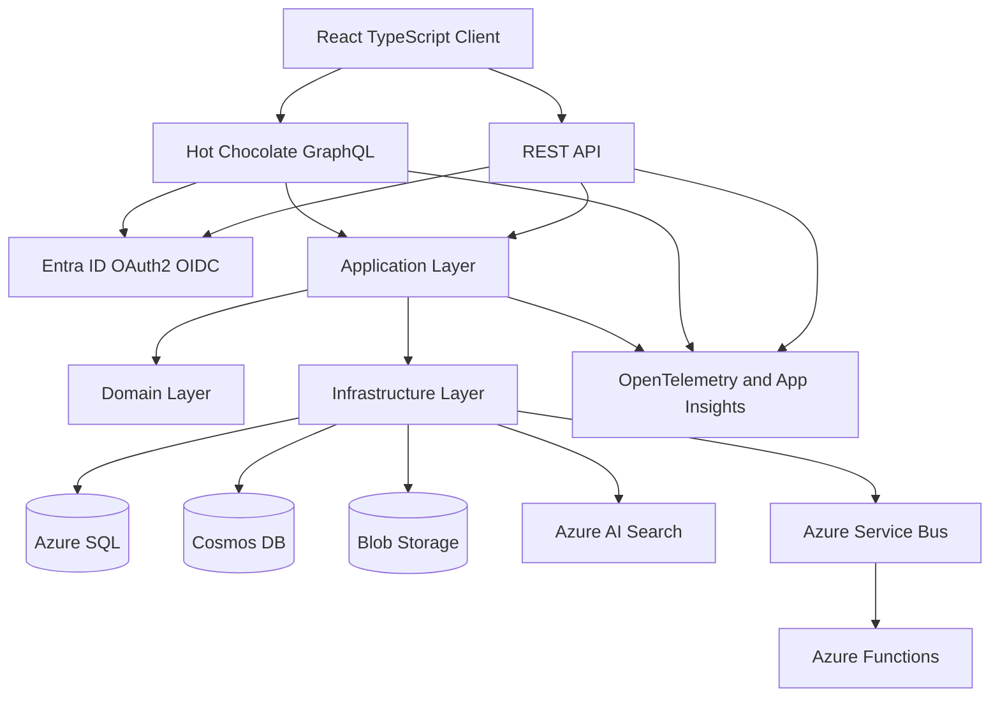

# LeaseCore
## Commercial Real Estate Lease Lifecycle & Accounting Platform

> A production-oriented, multi-tenant SaaS platform for managing commercial property portfolios, lease agreements, documents, critical dates, tasks, lease accounting workflows and compliance.

**Backend:** C# / ASP.NET Core / .NET 10  
**REST API documentation:** Scalar (OpenAPI)  
**GraphQL:** Hot Chocolate  
**Architecture:** Clean Architecture, Domain-Driven Design (DDD), CQRS  
**Databases:** SQL Server / Azure SQL + Azure Cosmos DB  
**Frontend:** React + TypeScript  
**Cloud:** Microsoft Azure  
**Repository status:** Architecture and implementation roadmap

---

## 1. Project vision

LeaseCore demonstrates how to design, implement, test, secure, observe and deploy the backend of a commercial real estate SaaS platform.

It is deliberately more than a property CRUD application. It models the business lifecycle around commercial leases and the operational and financial obligations that arise from them.

The platform supports:

1. **Portfolio and property management** — organisations, portfolios, properties, buildings, units, landlords and tenants.
2. **Lease lifecycle management** — lease creation, approval, execution, amendments, renewals, rent reviews, break clauses and termination.
3. **Document management** — secure upload, metadata, classification, versioning and retrieval of lease-related documents.
4. **Key dates and obligations** — expiry dates, notice windows, rent reviews, insurance renewals, inspections and recurring obligations.
5. **Task management** — assignable work, due dates, ownership, status transitions and escalation.
6. **Lease accounting** — payment schedules, discounting assumptions, right-of-use asset and lease liability calculations, journals and auditability.
7. **Search and reporting** — portfolio search, upcoming events, document discovery, operational reporting and accounting summaries.
8. **Compliance and audit** — immutable business audit events, controlled access and traceability of important changes.

The initial accounting scope is an **IFRS 16-oriented workflow**, not a claim of complete accounting-standard certification. Accounting policies, discount rates, exemptions, reassessments, modifications and journal treatment must be explicitly modelled, validated and reviewed by qualified accounting stakeholders.

## 2. Why this project matches the Senior Backend .NET Developer role

| Job requirement | LeaseCore implementation |
|---|---|
| C# / ASP.NET Core | .NET 10 ASP.NET Core Web API |
| GraphQL / Hot Chocolate | Typed GraphQL queries, mutations, filtering, sorting and pagination |
| Scalar API | OpenAPI-described REST endpoints rendered in Scalar |
| SQL / Azure SQL | Transactional relational model, migrations, indexes and reporting queries |
| Cosmos DB / MongoDB | Cosmos DB document store for activity and selected read-oriented data |
| Entity Framework Core | EF Core persistence, configurations, migrations and transaction boundaries |
| Azure services | App Service or Container Apps, Azure SQL, Cosmos DB, Blob Storage, Key Vault, Entra ID, Functions, Service Bus and AI Search |
| OAuth2 / OIDC / JWT | Entra ID integration, JWT bearer validation, policies and tenant-aware authorisation |
| RBAC | Roles, permissions, resource ownership and organisation/tenant boundaries |
| Clean Architecture | Domain, Application, Infrastructure and API boundaries |
| DDD | Aggregates, entities, value objects, domain events and bounded contexts |
| CQRS / MediatR | Separate command and query handlers with explicit application use cases |
| FluentValidation | Request and command validation |
| AutoMapper | Controlled mapping at application boundaries where useful |
| xUnit | Domain, application, API, integration and architecture tests |
| CI/CD | GitHub Actions and Azure DevOps pipeline definitions |
| Logging / monitoring | Structured logging, OpenTelemetry and Application Insights |
| React / TypeScript | Thin portfolio, lease, task and document management UI |
| Senior ownership | ADRs, threat model, operational runbooks, release gates and evidence-based milestones |

## 3. Proposed technology stack

Use stable, mutually compatible package versions available at implementation time. Pin SDKs and NuGet dependencies and update them deliberately.

### Backend

- .NET 10 / C# / ASP.NET Core
- ASP.NET Core Minimal APIs or controller endpoints for REST resources
- Scalar.AspNetCore for interactive OpenAPI documentation
- Hot Chocolate for GraphQL
- Entity Framework Core with SQL Server provider
- MediatR for command/query dispatch
- FluentValidation for input and command validation
- AutoMapper only where mapping complexity justifies it
- NLog or Serilog for structured logging (select one primary logging pipeline)
- OpenTelemetry for traces, metrics and logs

### Data

- SQL Server locally and Azure SQL in hosted environments
- Azure Cosmos DB for selected document-oriented and append-oriented records
- EF Core migrations for relational schema evolution
- Redis may be introduced for distributed caching after baseline correctness and measurements

**Data ownership rule:** SQL Server is the authoritative store for transactional lease, property, party, task and accounting records. Cosmos DB is not a second writable authority for the same aggregates. Define consistency and projection rules before introducing cross-store workflows.

### Azure

- Azure App Service or Azure Container Apps for API hosting
- Azure SQL Database for transactional data
- Azure Cosmos DB for document-oriented data
- Azure Blob Storage for uploaded documents
- Microsoft Entra ID for workforce identity and OIDC
- Azure Key Vault for secrets and certificates
- Azure Functions for scheduled and event-triggered workloads
- Azure Service Bus for reliable asynchronous integration
- Azure AI Search for document and portfolio search
- Application Insights for application telemetry

### Frontend

- React
- TypeScript
- Vite
- GraphQL client (for example, Apollo Client or urql)
- Typed REST client for operational endpoints where appropriate
- Component and end-to-end tests introduced with the relevant UI milestones

### Engineering and delivery

- xUnit
- FluentAssertions (subject to licensing and team policy) or native assertions
- Testcontainers for database-backed integration tests
- WireMock.Net for external service simulations
- Docker / Docker Compose
- GitHub Actions
- Azure DevOps YAML pipelines
- Bicep or Terraform for infrastructure as code (choose one for the first deployment path)

---

## 4. Architecture

LeaseCore uses Clean Architecture with DDD-informed bounded contexts and CQRS application workflows.



### Architectural rules

1. Domain code must not depend on ASP.NET Core, EF Core, Azure SDKs, GraphQL or infrastructure implementations.
2. Application use cases coordinate domain behaviour and depend on abstractions.
3. Infrastructure implements persistence, identity integration, storage, messaging and external services.
4. REST and GraphQL are delivery mechanisms. They must call the same application use cases rather than duplicate business logic.
5. Controllers, endpoint handlers and GraphQL resolvers remain thin.
6. Business invariants belong in domain objects and domain services, not UI components or controllers.
7. Commands represent state changes; queries return read models and must not mutate domain state.
8. External side effects are coordinated through reliable application workflows and an outbox where required.
9. Tenant identity is derived from validated claims and server-side membership, never trusted from arbitrary client-supplied tenant IDs.
10. Every important financial or contractual transition must be auditable.

### Bounded contexts

| Context | Responsibilities |
|---|---|
| Identity & Tenancy | Organisations, memberships, roles, permissions and tenant context |
| Portfolio | Portfolios, properties, buildings, units and ownership |
| Lease Management | Lease agreements, parties, terms, amendments and lifecycle |
| Documents | Metadata, versions, classifications, storage references and access |
| Obligations | Key dates, notice windows, recurring obligations and reminders |
| Work Management | Tasks, assignments, priorities, status and escalation |
| Lease Accounting | Payment schedules, assumptions, valuations, journals and accounting periods |
| Search & Reporting | Search projections, operational reports and portfolio read models |
| Audit | Security-relevant and business-critical audit events |

---

## 5. Repository structure

The repository is organised as a modular monolith first. This keeps deployment and local development manageable while preserving boundaries that can support future service extraction.

```text
LeaseCore/
├── LeaseCore.slnx
├── global.json
├── Directory.Build.props
├── Directory.Packages.props
├── .editorconfig
├── .gitignore
├── .dockerignore
├── README.md
├── LICENSE
├── SECURITY.md
├── CONTRIBUTING.md
│
├── src/
│   ├── BuildingBlocks/
│   │   ├── LeaseCore.BuildingBlocks.Domain/
│   │   ├── LeaseCore.BuildingBlocks.Application/
│   │   └── LeaseCore.BuildingBlocks.Infrastructure/
│   │
│   ├── Modules/
│   │   ├── Identity/
│   │   │   ├── LeaseCore.Identity.Domain/
│   │   │   ├── LeaseCore.Identity.Application/
│   │   │   └── LeaseCore.Identity.Infrastructure/
│   │   ├── Portfolio/
│   │   │   ├── LeaseCore.Portfolio.Domain/
│   │   │   ├── LeaseCore.Portfolio.Application/
│   │   │   └── LeaseCore.Portfolio.Infrastructure/
│   │   ├── Leases/
│   │   │   ├── LeaseCore.Leases.Domain/
│   │   │   ├── LeaseCore.Leases.Application/
│   │   │   └── LeaseCore.Leases.Infrastructure/
│   │   ├── Documents/
│   │   │   ├── LeaseCore.Documents.Domain/
│   │   │   ├── LeaseCore.Documents.Application/
│   │   │   └── LeaseCore.Documents.Infrastructure/
│   │   ├── Obligations/
│   │   │   ├── LeaseCore.Obligations.Domain/
│   │   │   ├── LeaseCore.Obligations.Application/
│   │   │   └── LeaseCore.Obligations.Infrastructure/
│   │   ├── WorkManagement/
│   │   │   ├── LeaseCore.WorkManagement.Domain/
│   │   │   ├── LeaseCore.WorkManagement.Application/
│   │   │   └── LeaseCore.WorkManagement.Infrastructure/
│   │   ├── Accounting/
│   │   │   ├── LeaseCore.Accounting.Domain/
│   │   │   ├── LeaseCore.Accounting.Application/
│   │   │   └── LeaseCore.Accounting.Infrastructure/
│   │   ├── Search/
│   │   │   ├── LeaseCore.Search.Application/
│   │   │   └── LeaseCore.Search.Infrastructure/
│   │   └── Audit/
│   │       ├── LeaseCore.Audit.Domain/
│   │       ├── LeaseCore.Audit.Application/
│   │       └── LeaseCore.Audit.Infrastructure/
│   │
│   ├── Hosts/
│   │   ├── LeaseCore.Api/
│   │   │   ├── Endpoints/
│   │   │   ├── GraphQL/
│   │   │   ├── Middleware/
│   │   │   ├── Authorization/
│   │   │   ├── OpenApi/
│   │   │   └── Program.cs
│   │   ├── LeaseCore.Worker/
│   │   └── LeaseCore.Functions/
│   │
│   └── Frontend/
│       └── leasecore-web/
│           ├── src/
│           │   ├── app/
│           │   ├── features/
│           │   ├── components/
│           │   ├── graphql/
│           │   ├── api/
│           │   └── routes/
│           ├── public/
│           └── package.json
│
├── tests/
│   ├── Unit/
│   │   ├── LeaseCore.Leases.UnitTests/
│   │   ├── LeaseCore.Accounting.UnitTests/
│   │   └── LeaseCore.Portfolio.UnitTests/
│   ├── Integration/
│   │   ├── LeaseCore.Api.IntegrationTests/
│   │   ├── LeaseCore.Persistence.IntegrationTests/
│   │   └── LeaseCore.Azure.IntegrationTests/
│   ├── Architecture/
│   │   └── LeaseCore.ArchitectureTests/
│   └── Contract/
│       └── LeaseCore.ContractTests/
│
├── deploy/
│   ├── docker/
│   ├── compose/
│   ├── bicep/
│   ├── scripts/
│   └── environments/
│       ├── development/
│       ├── staging/
│       └── production/
│
├── pipelines/
│   ├── github/
│   └── azure-devops/
│
└── docs/
    ├── architecture/
    │   ├── system-context.md
    │   ├── container-diagram.md
    │   ├── component-diagrams.md
    │   ├── data-flow.md
    │   └── decisions/
    ├── domain/
    │   ├── glossary.md
    │   ├── bounded-contexts.md
    │   ├── lease-lifecycle.md
    │   └── accounting-domain.md
    ├── database/
    │   ├── erd.md
    │   ├── sql-schema.md
    │   └── cosmos-data-model.md
    ├── api/
    │   ├── rest-api.md
    │   ├── graphql-schema.md
    │   └── authorization-matrix.md
    ├── security/
    │   ├── threat-model.md
    │   └── security-controls.md
    ├── operations/
    │   ├── runbook.md
    │   ├── backup-restore.md
    │   └── incident-response.md
    └── milestones/
        ├── implementation-roadmap.md
        └── acceptance-criteria.md
```

**Structure note:** The tree is the target architecture, not a claim that all projects and files already exist. Create projects incrementally as milestones require them. Avoid empty projects and premature microservices.

---

## 6. Domain model and core entities

### Portfolio

- `Organisation`
- `Portfolio`
- `Property`
- `Building`
- `Unit`
- `OwnershipInterest`

### Lease

- `Lease`
- `LeaseParty`
- `LeaseTerm`
- `LeaseAmendment`
- `RentSchedule`
- `RentReview`
- `LeaseOption`
- `LeaseCharge`
- `LeaseStatus`

### Documents

- `Document`
- `DocumentVersion`
- `DocumentCategory`
- `DocumentAccessGrant`
- `DocumentStorageReference`

The database stores document metadata and storage references. File bytes belong in Blob Storage, not SQL rows or Cosmos documents.

### Obligations and work

- `KeyDate`
- `Obligation`
- `Task`
- `TaskAssignment`
- `Reminder`
- `NotificationDelivery`

### Accounting

- `PaymentSchedule`
- `DiscountRateAssumption`
- `LeaseMeasurement`
- `RightOfUseAsset`
- `LeaseLiability`
- `JournalEntry`
- `JournalLine`
- `AccountingPeriod`
- `Reassessment`
- `Modification`

### Cross-cutting

- `Tenant`
- `UserMembership`
- `Role`
- `Permission`
- `AuditEvent`
- `OutboxMessage`
- `IdempotencyRecord`

### Important domain invariants

- A lease must belong to an organisation and a valid property/unit.
- Lease dates and option windows must be valid and internally consistent.
- A lease cannot transition through arbitrary status changes; transitions are explicit.
- An amendment must preserve the history of the original agreement and record its effective date.
- A document version is immutable after publication; replacement creates a new version.
- A task must have a valid tenant scope and an authorised assignee.
- Accounting journals must balance: total debits equal total credits for each journal and currency.
- Financial amounts use `decimal`, never binary floating point.
- Currency is explicit and cannot be silently mixed.
- Repeated commands with the same idempotency key must not create duplicate financial effects.
- Audit records for material actions must capture actor, tenant, action, target and timestamp.
- Cross-tenant access must be denied by default.

---

## 7. API strategy: REST + GraphQL + Scalar

REST and GraphQL serve different needs and share the same application layer.

### REST API

Use REST for explicit resource operations, health endpoints, file upload/download workflows, integration callbacks and operational endpoints.

Example endpoint catalogue:

| Method | Endpoint | Purpose |
|---|---|---|
| GET | `/health/live` | Process liveness |
| GET | `/health/ready` | Dependency readiness |
| GET | `/api/v1/portfolios` | List portfolios |
| POST | `/api/v1/portfolios` | Create portfolio |
| GET | `/api/v1/properties/{id}` | Get property |
| POST | `/api/v1/leases` | Create lease |
| GET | `/api/v1/leases/{id}` | Get lease details |
| POST | `/api/v1/leases/{id}/amendments` | Record amendment |
| POST | `/api/v1/leases/{id}/documents` | Initiate document upload |
| GET | `/api/v1/leases/{id}/key-dates` | List lease key dates |
| POST | `/api/v1/tasks` | Create task |
| POST | `/api/v1/leases/{id}/accounting/measurements` | Run a measurement workflow |
| GET | `/api/v1/reports/lease-expirations` | Expiry report |

Scalar provides the interactive REST documentation from the generated OpenAPI document. It is not a GraphQL schema explorer.

### Scalar setup concept

Register OpenAPI and Scalar in the API host, then expose the UI in development and in secured non-production environments.

```csharp
builder.Services.AddOpenApi();

var app = builder.Build();

if (app.Environment.IsDevelopment())
{
    app.MapOpenApi();
    app.MapScalarApiReference();
}

app.Run();
```

Use the package and extension APIs supported by the selected Scalar.AspNetCore version. Confirm the generated OpenAPI document includes authentication schemes, response types and error contracts.

### GraphQL API

Hot Chocolate exposes a typed API for frontend queries that combine related portfolio, property, lease, task and key-date data.

Illustrative query:

```graphql
query PortfolioOverview($portfolioId: UUID!) {
  portfolio(id: $portfolioId) {
    id
    name
    properties {
      id
      name
      leases {
        id
        reference
        status
        startDate
        endDate
        nextKeyDates {
          type
          dueDate
        }
      }
    }
  }
}
```

Illustrative mutation:

```graphql
mutation CreateLease($input: CreateLeaseInput!) {
  createLease(input: $input) {
    lease {
      id
      reference
      status
    }
    errors {
      code
      message
    }
  }
}
```

**GraphQL requirements:**

- Use Hot Chocolate query and mutation types.
- Keep resolvers thin and dispatch application queries/commands.
- Enforce authentication and authorisation at resolver and application boundaries.
- Prevent insecure object-level access and cross-tenant data leakage.
- Configure paging, filtering and sorting deliberately.
- Avoid N+1 queries using DataLoaders and measured query strategies.
- Set query depth, complexity and execution limits.
- Do not expose unrestricted EF entities as GraphQL types.
- Add schema and contract tests.
- Keep sensitive fields out of default projections.

---

## 8. Data architecture

### SQL Server / Azure SQL

SQL is the system of record for transactional business aggregates:

- Tenants and memberships
- Portfolios and properties
- Leases and amendments
- Rent schedules and obligations
- Tasks and assignments
- Accounting measurements and journals
- Idempotency records and outbox messages

Use EF Core configurations, explicit indexes, concurrency tokens and migrations. Apply tenant-scoped query filters as defence in depth, not as the only authorisation mechanism.

### Cosmos DB

Use Cosmos DB only for data that benefits from document-oriented access patterns, for example:

- Append-oriented activity timeline projections
- Search and reporting projection documents
- Selected integration snapshots
- Read-optimised portfolio summaries

Define partition keys from actual access patterns. Include tenant scope in the partitioning strategy where appropriate. Design for request-unit costs, document size, TTL, indexing and consistency requirements.

### Blob Storage

Store lease PDFs, amendments, certificates and other uploaded files in private containers. Persist metadata and storage references in SQL. Use short-lived, narrowly scoped upload/download authorisations; validate file size, extension, content type and file signature; scan uploads before making them available.

### Data consistency

- SQL transactions protect invariants within a relational aggregate boundary.
- Use an outbox to publish events reliably after committed changes.
- Consumers must be idempotent.
- Cross-store projections are eventually consistent and must expose their freshness where relevant.
- Do not attempt distributed transactions across SQL, Cosmos, Blob Storage and Service Bus.

---

## 9. Security model

### Authentication

Integrate Microsoft Entra ID using OAuth2/OIDC. Validate issuer, audience, signature, lifetime and allowed algorithms for bearer tokens. Use the appropriate interactive or service-to-service flow for each client.

### Authorisation

Use policy-based authorisation and tenant-aware resource checks.

Initial roles:

| Role | Example permissions |
|---|---|
| Platform Administrator | Platform-level administration |
| Organisation Administrator | Manage organisation users and settings |
| Portfolio Manager | Manage assigned portfolios and leases |
| Property Manager | Manage assigned properties, tasks and documents |
| Finance Manager | Access accounting workflows and reports |
| Auditor | Read authorised records and audit history |
| Tenant Viewer | Read explicitly shared tenant-facing information |

Roles are starting points, not a substitute for resource-level checks. A user with a role must still be restricted to the organisations, portfolios and resources to which they have access.

### Security controls

- Entra ID OIDC integration and JWT bearer validation
- Policy-based and resource-based authorisation
- Tenant isolation on every relevant query and command
- Least-privilege service identities and managed identities in Azure
- Key Vault for secrets and certificates
- No secrets in source control or container images
- Input validation and output shaping
- Rate limiting and request-size limits
- Secure file upload/download handling
- CORS allowlists and security headers
- Audit logging for sensitive operations
- Dependency and container vulnerability scanning
- Data retention, backup and restore procedures
- Threat modelling and security-focused integration tests

See `docs/security/` for the planned threat model and control catalogue.

---

## 10. CQRS and application workflow

Example command flow:

```text
HTTP or GraphQL request
        |
Authentication and tenant resolution
        |
Endpoint / GraphQL resolver
        |
MediatR command
        |
FluentValidation
        |
Application handler
        |
Domain aggregate and domain services
        |
EF Core transaction
        |
SQL Server commit + Outbox record
        |
Outbox publisher
        |
Azure Service Bus
        |
Consumers / projections / notifications
```

Example use cases:

- `CreatePortfolioCommand`
- `RegisterPropertyCommand`
- `CreateLeaseCommand`
- `ApproveLeaseCommand`
- `AmendLeaseCommand`
- `PublishDocumentVersionCommand`
- `ScheduleLeaseObligationsCommand`
- `AssignTaskCommand`
- `RunLeaseMeasurementCommand`
- `PostLeaseJournalCommand`

Queries:

- `GetPortfolioOverviewQuery`
- `GetLeaseDetailsQuery`
- `GetUpcomingKeyDatesQuery`
- `SearchLeaseDocumentsQuery`
- `GetLeaseAccountingSummaryQuery`
- `GetAuditHistoryQuery`

Do not introduce generic repositories or abstractions automatically. Use repository interfaces where they protect aggregate boundaries or isolate persistence behaviour. Keep query implementations efficient and observable.

---

## 11. Lease accounting scope

The accounting module should be a carefully bounded, test-heavy domain.

### Initial calculation workflow

1. Capture lease payment schedule and effective dates.
2. Capture approved discount-rate assumptions.
3. Generate dated contractual cash flows.
4. Calculate present value using documented conventions.
5. Record initial lease liability and right-of-use asset inputs.
6. Generate an amortisation schedule.
7. Calculate periodic interest and liability reductions.
8. Support controlled modifications and reassessments.
9. Generate balanced journal proposals.
10. Require an authorised posting workflow and preserve an audit trail.

### Financial engineering rules

- Use `decimal` and explicit precision/rounding policies.
- Store currency and effective dates with each financial assumption.
- Make day-count, payment timing and compounding conventions explicit.
- Version calculation inputs and calculation-engine rules.
- Preserve calculation outputs so they can be reproduced.
- Test edge cases: irregular periods, advance payments, arrears, partial periods, negative or zero rates where policy permits, modifications and rounding.
- Separate calculation from journal posting.
- Do not claim full IFRS 16 compliance until the relevant accounting policies and scenarios have been reviewed and validated.

---

## 12. Testing strategy

Testing is a delivery requirement, not a final milestone.

| Test type | What it verifies | Tools |
|---|---|---|
| Domain unit tests | Invariants, transitions and calculations | xUnit |
| Application unit tests | Handler behaviour and validation | xUnit, mocks/fakes |
| Integration tests | EF Core mappings, transactions and queries | xUnit, Testcontainers |
| API tests | REST routes, auth policies and error contracts | ASP.NET Core test host |
| GraphQL tests | Schema, resolver behaviour and tenant boundaries | Hot Chocolate test utilities |
| Contract tests | API compatibility and integration messages | xUnit |
| Architecture tests | Dependency direction and module boundaries | NetArchTest or equivalent |
| Security tests | Access denial, tenant isolation and token validation | Integration test suites |
| Frontend tests | Components and user workflows | Vitest / Testing Library |
| End-to-end tests | Critical user journeys | Playwright |

Minimum acceptance expectations:

- Every domain invariant has a test.
- Every command handler has success and failure-path tests.
- Tenant isolation is tested with at least two organisations.
- Duplicate financial commands are tested.
- SQL integration tests run against a real SQL Server-compatible engine, not only EF InMemory.
- GraphQL query complexity and paging constraints are verified.
- CI runs formatting, build, tests and security checks.

---

## 13. Observability and operations

Instrument the application from the first API milestone.

### Logging

Use structured logs with:

- Correlation / trace ID
- Tenant ID (non-sensitive identifier)
- Actor ID (non-sensitive identifier)
- Request route and operation
- Result and duration
- Exception category

Never log bearer tokens, passwords, document contents, payment credentials or sensitive personal data.

### Metrics

Track:

- Request rate, latency and error rate
- GraphQL operation duration and complexity
- SQL connection and query latency
- Cosmos DB request units and throttling
- Queue depth and message processing failures
- Background job duration and failure rate
- Document upload and processing failures
- Lease accounting calculation failures

### Tracing

Use OpenTelemetry instrumentation for ASP.NET Core, HttpClient, EF Core where supported, and messaging. Export to Application Insights or an OpenTelemetry-compatible collector.

### Operational readiness

Document health checks, readiness dependencies, structured error responses, alert thresholds, dashboards, backup/restore, deployment rollback and incident response.

---

## 14. CI/CD and deployment

Use GitHub Actions for repository validation and an Azure DevOps YAML pipeline to demonstrate enterprise delivery. Keep pipeline stages and quality gates equivalent.

### Pull request pipeline

1. Checkout and install the pinned .NET SDK.
2. Restore NuGet dependencies.
3. Verify formatting.
4. Build the solution in Release configuration.
5. Run unit tests.
6. Run architecture and integration tests where infrastructure is available.
7. Generate test results and coverage reports.
8. Scan dependencies and container images.
9. Build container image.
10. Publish build artifacts.

### Deployment pipeline

```text
Pull Request
    |
Build + Test + Security Checks
    |
Merge to main
    |
Build immutable container image
    |
Deploy to Development
    |
Smoke Tests + Health Checks
    |
Approval Gate
    |
Deploy to Staging
    |
Integration / Acceptance Tests
    |
Production Approval
    |
Deploy to Production
    |
Post-deployment Verification
```

### Azure deployment target

- API: Azure Container Apps or App Service
- Database: Azure SQL
- NoSQL: Azure Cosmos DB
- Documents: Azure Blob Storage
- Identity: Microsoft Entra ID
- Secrets: Azure Key Vault
- Messaging: Azure Service Bus
- Search: Azure AI Search
- Jobs: Azure Functions
- Telemetry: Application Insights and Azure Monitor

Do not provision every Azure service in the first milestone. Start with local development and add cloud dependencies when the corresponding feature is implemented.

---

## 15. Implementation roadmap: P0–P10

Each milestone has an implementation outcome and evidence gate. A milestone is complete only when code, tests, documentation and verification support that status.

### P0 — Architecture, scope and engineering foundation

**Deliverables**
- Create repository and root `LeaseCore.slnx`.
- Pin .NET 10 SDK with `global.json`.
- Configure central package management.
- Add `.editorconfig`, build properties and analyzers.
- Document domain glossary, bounded contexts and initial ADRs.
- Establish naming, error-handling and dependency rules.
- Add initial architecture diagrams and implementation plan.

**Acceptance**
- Solution restores and builds.
- Architecture decisions are committed.
- No application or domain project has an infrastructure dependency.

### P1 — API host, Scalar and operational baseline

**Deliverables**
- Create ASP.NET Core API host.
- Add REST versioning strategy.
- Configure OpenAPI and Scalar.
- Add health liveness/readiness endpoints.
- Add global exception handling and Problem Details.
- Add configuration validation and structured logging.
- Add Dockerfile and local Compose baseline.

**Acceptance**
- API starts locally.
- Scalar renders the OpenAPI document.
- Health endpoints return correct status.
- Invalid configuration fails fast.
- API integration tests pass.

### P2 — Persistence foundation and tenancy

**Deliverables**
- Configure SQL Server and EF Core.
- Add initial tenant, organisation and membership model.
- Add entity configurations, migrations and indexes.
- Add tenant context resolution.
- Implement tenant-scoped data access and concurrency strategy.
- Add database integration tests.

**Acceptance**
- Migrations apply to a clean database.
- Two-tenant isolation tests pass.
- Queries cannot return another tenant's records.
- Concurrency conflicts are handled predictably.

### P3 — Identity, OAuth2/OIDC and RBAC

**Deliverables**
- Integrate Entra ID authentication.
- Configure JWT bearer validation.
- Add policy-based authorisation.
- Add organisation membership and role/permission checks.
- Add resource-level access checks.
- Add security and negative-path tests.

**Acceptance**
- Unauthenticated requests are rejected.
- Authenticated users cannot cross tenant boundaries.
- Role and resource policies are tested.
- No secrets are committed.

### P4 — Portfolio and property domain

**Deliverables**
- Implement portfolio, property, building and unit aggregates.
- Add create, update, archive and retrieval use cases.
- Add REST endpoints and GraphQL read operations.
- Add validation and audit events.
- Add filtering, sorting and pagination.

**Acceptance**
- Domain invariants are unit-tested.
- REST and GraphQL use the same application layer.
- Tenant isolation and pagination tests pass.

### P5 — Lease lifecycle and contractual terms

**Deliverables**
- Implement lease aggregate and lifecycle transitions.
- Add parties, dates, terms, rent schedules and options.
- Add lease creation, approval and activation workflows.
- Add amendments with effective dates and history.
- Add GraphQL queries and mutations.
- Add lease lifecycle diagrams and contract tests.

**Acceptance**
- Invalid transitions are rejected.
- Amendments preserve historical state.
- Lease dates and terms are validated.
- Critical use cases have unit and integration tests.

### P6 — Documents, Blob Storage and search

**Deliverables**
- Add document metadata and versioning.
- Integrate private Azure Blob Storage.
- Implement secure upload/download authorisation.
- Add file validation and malware-scanning integration seam.
- Add Cosmos DB for a justified document-oriented projection or activity feed.
- Integrate Azure AI Search for authorised document discovery.

**Acceptance**
- Document bytes are not stored in SQL.
- Access is tenant- and resource-scoped.
- Version history is preserved.
- Search results do not leak unauthorised metadata.

### P7 — Key dates, obligations, tasks and notifications

**Deliverables**
- Implement key dates and recurring obligations.
- Add task assignment, status and escalation.
- Add Azure Functions for scheduled processing.
- Add Service Bus events and outbox publishing.
- Add notification adapter and retry/dead-letter handling.
- Add calendar-oriented GraphQL read models.

**Acceptance**
- Scheduled work is idempotent.
- Duplicate events do not create duplicate tasks or notifications.
- Failed messages are observable and recoverable.
- Due-date calculations have timezone-aware tests.

### P8 — Lease accounting and financial controls

**Deliverables**
- Implement payment schedule generation.
- Add discount-rate assumptions and present-value calculations.
- Add right-of-use asset and lease-liability measurement workflow.
- Add amortisation schedule.
- Add balanced journal proposal and posting workflow.
- Add idempotency and audit controls.
- Document accounting assumptions and limitations.

**Acceptance**
- Calculation scenarios have deterministic tests.
- Decimal precision and rounding policies are explicit.
- Journals balance by currency.
- Duplicate posting attempts are safely rejected.
- Modifications and reassessments preserve history.

### P9 — React/TypeScript frontend and reporting

**Deliverables**
- Create React + TypeScript application shell.
- Add Entra ID sign-in integration.
- Add portfolio overview and property pages.
- Add lease details, key dates and task workflows.
- Add document list and upload workflow.
- Add accounting summary and reporting screens.
- Integrate GraphQL and typed REST clients.

**Acceptance**
- Core journeys work against the real API.
- Loading, empty and error states are handled.
- Frontend permissions mirror backend policy outcomes.
- No business rules are implemented exclusively in the UI.

### P10 — Production hardening, Azure deployment and release

**Deliverables**
- Complete OpenTelemetry instrumentation.
- Configure Application Insights dashboards and alerts.
- Add Azure infrastructure as code.
- Finalise GitHub Actions and Azure DevOps pipelines.
- Add container and dependency scanning.
- Add load, resilience and security tests.
- Document backup/restore, deployment and incident runbooks.
- Deploy to a non-production Azure environment.
- Record release evidence and known limitations.

**Acceptance**
- Release pipeline is repeatable.
- Health checks and smoke tests pass after deployment.
- Critical alerts and traces are demonstrable.
- Backup/restore procedure is documented and tested.
- No milestone is marked complete without verifiable evidence.

---

## 16. Suggested first vertical slice

Do not implement all modules simultaneously. Build one end-to-end workflow that proves the architecture.

**First slice: Create and retrieve a tenant-scoped lease.**

1. Resolve authenticated user and organisation membership.
2. Create a portfolio and property.
3. Create a lease with parties, dates and basic financial terms.
4. Persist the lease through EF Core.
5. Retrieve lease details through REST.
6. Retrieve the same lease through GraphQL.
7. Render REST documentation in Scalar.
8. Verify a different tenant cannot retrieve the lease.
9. Verify invalid dates and invalid lifecycle transitions are rejected.
10. Run automated tests in CI.

This establishes the core architectural path before adding Blob Storage, Cosmos DB, messaging and accounting complexity.

---

## 17. Local development setup

### Prerequisites

- .NET 10 SDK
- Visual Studio 2026 or compatible IDE
- Docker Desktop
- SQL Server container or local SQL Server instance
- Node.js LTS and npm
- Git
- Azure CLI (for cloud milestones)

### Initial verification commands

```powershell
dotnet --info
dotnet --list-sdks
docker --version
node --version
npm --version
git --version
```

### Suggested initial commands

Run from the repository root after creating the initial solution:

```powershell
dotnet new sln -n LeaseCore
dotnet new webapi -n LeaseCore.Api -o src/Hosts/LeaseCore.Api
dotnet sln LeaseCore.sln add src/Hosts/LeaseCore.Api/LeaseCore.Api.csproj
dotnet restore
dotnet build -c Release
dotnet test -c Release
```

The command above creates the traditional `.sln` format. If using the newer `.slnx` format supported by the installed SDK, create or convert the solution using the SDK's supported solution-format command and keep the final `LeaseCore.slnx` at the repository root. Verify the exact command against the installed SDK rather than assuming all SDK versions expose identical syntax.

### Configuration

Use environment variables or .NET user secrets locally. Example variable names:

```text
ConnectionStrings__LeaseCore
Authentication__Authority
Authentication__Audience
Azure__BlobStorage__ServiceUri
Azure__Cosmos__Endpoint
Azure__ServiceBus__FullyQualifiedNamespace
ApplicationInsights__ConnectionString
```

Never commit actual credentials, connection strings, signing keys or production tenant data.

---

## 18. Documentation deliverables

The repository should include:

- System context and container architecture diagrams
- Bounded-context and domain glossary documentation
- Lease lifecycle state machine
- ERD and SQL data model
- Cosmos DB partition and document design
- REST API contract and Scalar screenshots
- GraphQL schema and query examples
- Role/permission matrix
- Threat model and security controls
- ADRs for key technical decisions
- Accounting calculation assumptions and test cases
- CI/CD architecture and deployment guide
- Local development guide
- Operations, backup/restore and incident runbooks
- Milestone acceptance evidence

Suggested ADRs:

1. Modular monolith before microservices
2. SQL Server as transactional system of record
3. Cosmos DB projection ownership and partition strategy
4. REST and GraphQL sharing application use cases
5. Entra ID authentication and tenant authorisation
6. Outbox pattern for reliable event publication
7. Blob Storage for document bytes
8. Decimal and rounding policy for financial calculations
9. Observability standards and correlation propagation

---

## 19. GitHub presentation strategy

### Repository name

`LeaseCore`

### Short description

`Enterprise commercial lease management and lease accounting platform built with .NET 10, Hot Chocolate GraphQL, Scalar, EF Core, Azure SQL, Cosmos DB and React.`

### Suggested topics

```text
dotnet
dotnet10
csharp
aspnet-core
scalar
graphql
hotchocolate
entity-framework-core
azure-sql
cosmos-db
clean-architecture
domain-driven-design
cqrs
mediatr
oauth2
entra-id
azure
react
typescript
lease-management
commercial-real-estate
lease-accounting
```

### Recommended README badges

Only add badges that point to real workflows, test reports, releases or coverage. Do not display passing build or coverage badges before the corresponding pipeline exists and passes.

### Portfolio evidence to publish

- Architecture and ADRs
- ERD and domain diagrams
- OpenAPI and GraphQL contracts
- Unit and integration test reports
- CI/CD workflow definitions and successful runs
- Docker Compose local environment
- Azure deployment evidence (when deployed)
- Screenshots or short recordings of working workflows
- Security and operational runbooks

---

## 20. Definition of done

A feature is not complete merely because its endpoint returns HTTP 200.

A feature is complete when:

- Its domain rules and failure cases are understood.
- Its application use case is implemented and validated.
- Its persistence behaviour is tested.
- Its REST and/or GraphQL contract is documented.
- Its authorisation and tenant boundaries are verified.
- Its logs, traces and operational failure modes are considered.
- Its automated tests pass.
- Its documentation and ADRs are updated where necessary.
- Its CI pipeline passes.
- Its deployment and rollback implications are understood.

## 21. Scope discipline and implementation order

The project should remain a modular monolith until there is measurable evidence that a bounded context needs independent deployment or scaling.

Do not add Kafka, Kubernetes, microservices, event sourcing or multiple databases merely to make the architecture look enterprise-grade. The JD calls for sound engineering judgement, not maximum technology count.

The strongest demonstration is a coherent system in which:

- SQL owns transactional truth.
- Cosmos DB has a clear document/projection responsibility.
- GraphQL and REST share the same application workflows.
- Entra ID authentication is complemented by tenant-aware authorisation.
- Events are reliable and idempotent.
- Financial calculations are deterministic and auditable.
- Tests protect domain invariants.
- Telemetry makes production behaviour diagnosable.
- CI/CD can build, test and deploy repeatably.

---

## 22. Final project outcome

At completion, LeaseCore should demonstrate practical capability across the full backend lifecycle expected of a senior .NET engineer:

**Scope → Model → Architect → Implement → Secure → Test → Observe → Deploy → Operate**

The central portfolio story is not simply that the project uses .NET 10, GraphQL and Azure. It is that the implementation demonstrates why each technology is present, how the boundaries work, how failure is handled and what evidence proves that the system is reliable.

> Build the first vertical slice well, then expand through P0–P10. Prioritise working software, measurable quality gates and honest implementation evidence over an impressive but unverified repository structure.
