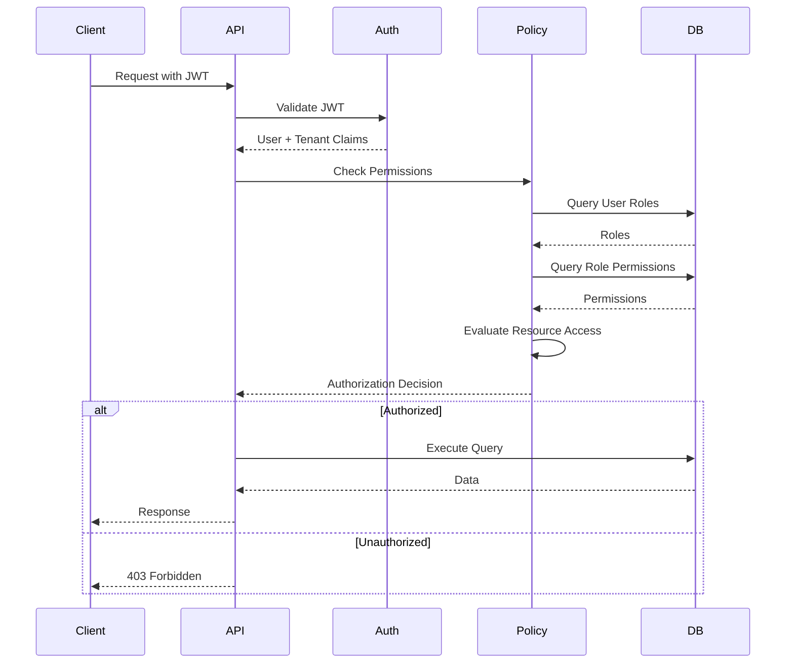

# Authorization Matrix

## Overview

This document defines the authorization matrix for the LeaseCore platform, including roles, permissions, and resource access patterns.

## Roles

| Role | Description |
|------|-------------|
| **System Administrator** | Full system access, tenant management, user administration |
| **Portfolio Manager** | Manage portfolios, properties, and leases |
| **Lease Administrator** | Full lease lifecycle management |
| **Lease Viewer** | Read-only access to lease data |
| **Document Manager** | Manage documents and access grants |
| **Accountant** | Lease accounting and financial reporting |
| **Task Manager** | Create and manage tasks |
| **Auditor** | Read-only access to audit logs and reports |
| **Tenant User** | Basic access to assigned resources |

## Permissions

### Portfolio Permissions

| Permission | Description |
|------------|-------------|
| `portfolio:read` | View portfolios |
| `portfolio:create` | Create portfolios |
| `portfolio:update` | Update portfolios |
| `portfolio:delete` | Delete portfolios |

### Property Permissions

| Permission | Description |
|------------|-------------|
| `property:read` | View properties |
| `property:create` | Create properties |
| `property:update` | Update properties |
| `property:delete` | Delete properties |

### Lease Permissions

| Permission | Description |
|------------|-------------|
| `lease:read` | View leases |
| `lease:create` | Create leases |
| `lease:update` | Update leases |
| `lease:delete` | Delete leases |
| `lease:approve` | Approve lease submissions |
| `lease:amend` | Create lease amendments |
| `lease:terminate` | Initiate lease termination |

### Document Permissions

| Permission | Description |
|------------|-------------|
| `document:read` | View documents |
| `document:create` | Upload documents |
| `document:update` | Update document metadata |
| `document:delete` | Delete documents |
| `document:download` | Download document files |
| `document:grant` | Grant document access |

### Task Permissions

| Permission | Description |
|------------|-------------|
| `task:read` | View tasks |
| `task:create` | Create tasks |
| `task:update` | Update tasks |
| `task:delete` | Delete tasks |
| `task:assign` | Assign tasks to users |
| `task:complete` | Mark tasks as complete |

### Accounting Permissions

| Permission | Description |
|------------|-------------|
| `accounting:read` | View accounting data |
| `accounting:create` | Create accounting measurements |
| `accounting:update` | Update accounting data |
| `accounting:delete` | Delete accounting records |
| `accounting:approve` | Approve journal entries |

### Audit Permissions

| Permission | Description |
|------------|-------------|
| `audit:read` | View audit logs |
| `audit:export` | Export audit logs |

### Reporting Permissions

| Permission | Description |
|------------|-------------|
| `report:read` | View reports |
| `report:export` | Export reports |

## Role-Permission Matrix

```mermaid
flowchart TB
    subgraph "Roles"
        SysAdmin[System Administrator]
        PortMgr[Portfolio Manager]
        LeaseAdmin[Lease Administrator]
        LeaseViewer[Lease Viewer]
        DocMgr[Document Manager]
        Accountant[Accountant]
        TaskMgr[Task Manager]
        Auditor[Auditor]
        TenantUser[Tenant User]
    end

    subgraph "Permissions"
        PortR[portfolio:read]
        PortC[portfolio:create]
        PortU[portfolio:update]
        PortD[portfolio:delete]

        PropR[property:read]
        PropC[property:create]
        PropU[property:update]
        PropD[property:delete]

        LeaseR[lease:read]
        LeaseC[lease:create]
        LeaseU[lease:update]
        LeaseD[lease:delete]
        LeaseA[lease:approve]
        LeaseAm[lease:amend]
        LeaseT[lease:terminate]

        DocR[document:read]
        DocC[document:create]
        DocU[document:update]
        DocD[document:delete]
        DocDL[document:download]
        DocG[document:grant]

        TaskR[task:read]
        TaskC[task:create]
        TaskU[task:update]
        TaskD[task:delete]
        TaskAs[task:assign]
        TaskCo[task:complete]

        AccR[accounting:read]
        AccC[accounting:create]
        AccU[accounting:update]
        AccD[accounting:delete]
        AccAp[accounting:approve]

        AuditR[audit:read]
        AuditE[audit:export]

        ReportR[report:read]
        ReportE[report:export]
    end

    SysAdmin --> PortR
    SysAdmin --> PortC
    SysAdmin --> PortU
    SysAdmin --> PortD
    SysAdmin --> PropR
    SysAdmin --> PropC
    SysAdmin --> PropU
    SysAdmin --> PropD
    SysAdmin --> LeaseR
    SysAdmin --> LeaseC
    SysAdmin --> LeaseU
    SysAdmin --> LeaseD
    SysAdmin --> LeaseA
    SysAdmin --> LeaseAm
    SysAdmin --> LeaseT
    SysAdmin --> DocR
    SysAdmin --> DocC
    SysAdmin --> DocU
    SysAdmin --> DocD
    SysAdmin --> DocDL
    SysAdmin --> DocG
    SysAdmin --> TaskR
    SysAdmin --> TaskC
    SysAdmin --> TaskU
    SysAdmin --> TaskD
    SysAdmin --> TaskAs
    SysAdmin --> TaskCo
    SysAdmin --> AccR
    SysAdmin --> AccC
    SysAdmin --> AccU
    SysAdmin --> AccD
    SysAdmin --> AccAp
    SysAdmin --> AuditR
    SysAdmin --> AuditE
    SysAdmin --> ReportR
    SysAdmin --> ReportE

    PortMgr --> PortR
    PortMgr --> PortC
    PortMgr --> PortU
    PortMgr --> PropR
    PortMgr --> PropC
    PortMgr --> PropU
    PortMgr --> LeaseR
    PortMgr --> TaskR
    PortMgr --> TaskC
    PortMgr --> TaskU
    PortMgr --> ReportR

    LeaseAdmin --> LeaseR
    LeaseAdmin --> LeaseC
    LeaseAdmin --> LeaseU
    LeaseAdmin --> LeaseA
    LeaseAdmin --> LeaseAm
    LeaseAdmin --> LeaseT
    LeaseAdmin --> DocR
    LeaseAdmin --> DocC
    LeaseAdmin --> DocU
    LeaseAdmin --> DocDL
    LeaseAdmin --> TaskR
    LeaseAdmin --> TaskC
    LeaseAdmin --> TaskU
    LeaseAdmin --> TaskAs
    LeaseAdmin --> ReportR

    LeaseViewer --> LeaseR
    LeaseViewer --> DocR
    LeaseViewer --> DocDL
    LeaseViewer --> ReportR

    DocMgr --> DocR
    DocMgr --> DocC
    DocMgr --> DocU
    DocMgr --> DocD
    DocMgr --> DocDL
    DocMgr --> DocG

    Accountant --> LeaseR
    Accountant --> AccR
    Accountant --> AccC
    Accountant --> AccU
    Accountant --> AccAp
    Accountant --> ReportR
    Accountant --> ReportE

    TaskMgr --> TaskR
    TaskMgr --> TaskC
    TaskMgr --> TaskU
    TaskMgr --> TaskD
    TaskMgr --> TaskAs
    TaskMgr --> TaskCo

    Auditor --> LeaseR
    Auditor --> AuditR
    Auditor --> AuditE
    Auditor --> ReportR
    Auditor --> ReportE

    TenantUser --> LeaseR
    TenantUser --> DocR
    TenantUser --> DocDL
    TenantUser --> TaskR
    TenantUser --> ReportR
```



## Permission Assignment Table

| Permission | Sys Admin | Port Mgr | Lease Admin | Lease Viewer | Doc Mgr | Accountant | Task Mgr | Auditor | Tenant User |
|------------|-----------|----------|-------------|---------------|---------|------------|----------|----------|-------------|
| portfolio:read | ✅ | ✅ | ❌ | ❌ | ❌ | ❌ | ❌ | ❌ | ❌ |
| portfolio:create | ✅ | ✅ | ❌ | ❌ | ❌ | ❌ | ❌ | ❌ | ❌ |
| portfolio:update | ✅ | ✅ | ❌ | ❌ | ❌ | ❌ | ❌ | ❌ | ❌ |
| portfolio:delete | ✅ | ❌ | ❌ | ❌ | ❌ | ❌ | ❌ | ❌ | ❌ |
| property:read | ✅ | ✅ | ❌ | ❌ | ❌ | ❌ | ❌ | ❌ | ❌ |
| property:create | ✅ | ✅ | ❌ | ❌ | ❌ | ❌ | ❌ | ❌ | ❌ |
| property:update | ✅ | ✅ | ❌ | ❌ | ❌ | ❌ | ❌ | ❌ | ❌ |
| property:delete | ✅ | ❌ | ❌ | ❌ | ❌ | ❌ | ❌ | ❌ | ❌ |
| lease:read | ✅ | ✅ | ✅ | ✅ | ❌ | ✅ | ❌ | ✅ | ✅ |
| lease:create | ✅ | ❌ | ✅ | ❌ | ❌ | ❌ | ❌ | ❌ | ❌ |
| lease:update | ✅ | ❌ | ✅ | ❌ | ❌ | ❌ | ❌ | ❌ | ❌ |
| lease:delete | ✅ | ❌ | ✅ | ❌ | ❌ | ❌ | ❌ | ❌ | ❌ |
| lease:approve | ✅ | ❌ | ✅ | ❌ | ❌ | ❌ | ❌ | ❌ | ❌ |
| lease:amend | ✅ | ❌ | ✅ | ❌ | ❌ | ❌ | ❌ | ❌ | ❌ |
| lease:terminate | ✅ | ❌ | ✅ | ❌ | ❌ | ❌ | ❌ | ❌ | ❌ |
| document:read | ✅ | ❌ | ✅ | ✅ | ✅ | ❌ | ❌ | ❌ | ✅ |
| document:create | ✅ | ❌ | ✅ | ❌ | ✅ | ❌ | ❌ | ❌ | ❌ |
| document:update | ✅ | ❌ | ✅ | ❌ | ✅ | ❌ | ❌ | ❌ | ❌ |
| document:delete | ✅ | ❌ | ❌ | ❌ | ✅ | ❌ | ❌ | ❌ | ❌ |
| document:download | ✅ | ❌ | ✅ | ✅ | ✅ | ❌ | ❌ | ❌ | ✅ |
| document:grant | ✅ | ❌ | ❌ | ❌ | ✅ | ❌ | ❌ | ❌ | ❌ |
| task:read | ✅ | ✅ | ✅ | ❌ | ❌ | ❌ | ✅ | ❌ | ✅ |
| task:create | ✅ | ✅ | ✅ | ❌ | ❌ | ❌ | ✅ | ❌ | ❌ |
| task:update | ✅ | ✅ | ✅ | ❌ | ❌ | ❌ | ✅ | ❌ | ❌ |
| task:delete | ✅ | ❌ | ❌ | ❌ | ❌ | ❌ | ✅ | ❌ | ❌ |
| task:assign | ✅ | ❌ | ✅ | ❌ | ❌ | ❌ | ✅ | ❌ | ❌ |
| task:complete | ✅ | ❌ | ❌ | ❌ | ❌ | ❌ | ✅ | ❌ | ❌ |
| accounting:read | ✅ | ❌ | ❌ | ❌ | ❌ | ✅ | ❌ | ❌ | ❌ |
| accounting:create | ✅ | ❌ | ❌ | ❌ | ❌ | ✅ | ❌ | ❌ | ❌ |
| accounting:update | ✅ | ❌ | ❌ | ❌ | ❌ | ✅ | ❌ | ❌ | ❌ |
| accounting:delete | ✅ | ❌ | ❌ | ❌ | ❌ | ❌ | ❌ | ❌ | ❌ |
| accounting:approve | ✅ | ❌ | ❌ | ❌ | ❌ | ✅ | ❌ | ❌ | ❌ |
| audit:read | ✅ | ❌ | ❌ | ❌ | ❌ | ❌ | ❌ | ✅ | ❌ |
| audit:export | ✅ | ❌ | ❌ | ❌ | ❌ | ❌ | ❌ | ✅ | ❌ |
| report:read | ✅ | ✅ | ✅ | ✅ | ❌ | ✅ | ❌ | ✅ | ✅ |
| report:export | ✅ | ❌ | ❌ | ❌ | ❌ | ✅ | ❌ | ✅ | ❌ |

## Resource-Level Authorization

### Tenant Isolation

All resources are scoped to a tenant. Users can only access resources within their tenant membership.

### Ownership-Based Access

Some resources have ownership-based access control:

| Resource | Ownership Field | Access Rule |
|----------|----------------|-------------|
| Task | Created by or assigned to | User can view and update their own tasks or tasks assigned to them |
| Document | Access grants | User can view documents they have been granted access to |

### Organization Scoping

Users within an organization can access that organization's resources. Cross-organization access requires explicit permissions.

## Authorization Flow



## Implementation

### Policy-Based Authorization

Use ASP.NET Core policy-based authorization:

```csharp
services.AddAuthorization(options =>
{
    options.AddPolicy("Lease:Create", policy =>
        policy.RequireClaim("permission", "lease:create"));

    options.AddPolicy("Lease:Approve", policy =>
        policy.RequireClaim("permission", "lease:approve")
              .RequireRole("LeaseAdministrator", "SystemAdministrator"));
});
```

### Resource-Based Authorization

Implement resource-based authorization handlers:

```csharp
public class TaskAuthorizationHandler :
    AuthorizationHandler<OperationAuthorizationRequirement, Task>
{
    protected override Task HandleRequirementAsync(
        AuthorizationHandlerContext context,
        OperationAuthorizationRequirement requirement,
        Task resource)
    {
        // Check if user is assigned to the task
        if (resource.Assignments.Any(a => a.UserId == context.User.UserId))
        {
            context.Succeed(requirement);
        }

        return Task.CompletedTask;
    }
}
```

### GraphQL Authorization

Use GraphQL directives for authorization:

```graphql
type Mutation {
  deleteLease(id: UUID!): DeleteLeasePayload!
    @auth(require: "lease:delete")
}
```

## Security Considerations

1. **Defense in Depth**: Apply tenant-scoped query filters in addition to authorization checks
2. **Least Privilege**: Grant minimum required permissions
3. **Regular Audits**: Review role assignments and permissions
4. **Permission Revocation**: Support immediate permission revocation
5. **Audit Logging**: Log all authorization decisions for security audits
