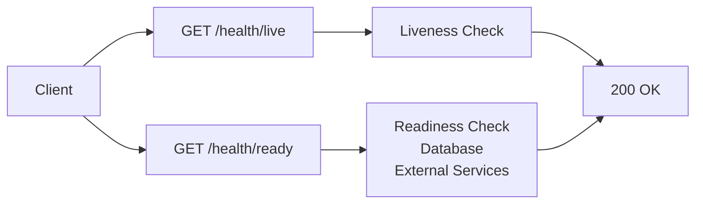

# REST API Design

## API Overview

The REST API follows RESTful principles with resource-oriented endpoints, proper HTTP methods, status codes, and consistent response formats.

## Base URL

```
https://api.leasecore.com/api/v1
```

## Authentication

All endpoints require authentication via JWT Bearer token:

```
Authorization: Bearer <jwt-token>
```

## Common Headers

| Header | Description |
|--------|-------------|
| `Authorization` | JWT Bearer token |
| `Content-Type` | `application/json` |
| `X-Tenant-Id` | Tenant identifier (optional, derived from JWT) |
| `X-Idempotency-Key` | Idempotency key for safe retries |
| `X-Correlation-Id` | Correlation ID for distributed tracing |

## Common Response Format

### Success Response

```json
{
  "data": { /* resource data */ },
  "meta": {
    "timestamp": "2026-01-15T10:30:00Z",
    "correlationId": "req-uuid"
  }
}
```

### Error Response

```json
{
  "error": {
    "code": "VALIDATION_ERROR",
    "message": "Invalid input data",
    "details": [
      {
        "field": "email",
        "message": "Email is required"
      }
    ],
    "requestId": "req-uuid",
    "timestamp": "2026-01-15T10:30:00Z"
  }
}
```

## Endpoints

### Health Endpoints



#### GET /health/live

Process liveness check.

**Response:** `200 OK`

#### GET /health/ready

Dependency readiness check.

**Response:** `200 OK` or `503 Service Unavailable`

### Portfolio Endpoints

```mermaid
flowchart TB
    subgraph "Portfolio API"
        ListPortfolios[GET /portfolios]
        CreatePortfolio[POST /portfolios]
        GetPortfolio[GET /portfolios/{id}]
        UpdatePortfolio[PUT /portfolios/{id}]
        DeletePortfolio[DELETE /portfolios/{id}]

        ListProperties[GET /properties]
        CreateProperty[POST /properties]
        GetProperty[GET /properties/{id}]
        UpdateProperty[PUT /properties/{id}]

        ListBuildings[GET /buildings]
        CreateBuilding[POST /buildings]
        GetBuilding[GET /buildings/{id}]

        ListUnits[GET /units]
        CreateUnit[POST /units]
        GetUnit[GET /units/{id}]
    end

    Client --> ListPortfolios
    Client --> CreatePortfolio
    Client --> GetPortfolio
    Client --> UpdatePortfolio
    Client --> DeletePortfolio
    Client --> ListProperties
    Client --> CreateProperty
    Client --> GetProperty
    Client --> UpdateProperty
    Client --> ListBuildings
    Client --> CreateBuilding
    Client --> GetBuilding
    Client --> ListUnits
    Client --> CreateUnit
    Client --> GetUnit
```

#### GET /portfolios

List portfolios for the current tenant.

**Query Parameters:**
- `page` (integer, default: 1)
- `pageSize` (integer, default: 20)
- `search` (string, optional)
- `sortBy` (string, optional)

**Response:** `200 OK`

```json
{
  "data": [
    {
      "id": "portfolio-uuid",
      "name": "Downtown Portfolio",
      "description": "Commercial properties in downtown area",
      "propertyCount": 15,
      "createdAt": "2026-01-01T00:00:00Z",
      "updatedAt": "2026-01-15T00:00:00Z"
    }
  ],
  "meta": {
    "page": 1,
    "pageSize": 20,
    "totalItems": 45,
    "totalPages": 3
  }
}
```

#### POST /portfolios

Create a new portfolio.

**Request Body:**

```json
{
  "name": "Downtown Portfolio",
  "description": "Commercial properties in downtown area"
}
```

**Response:** `201 Created`

#### GET /portfolios/{id}

Get a specific portfolio.

**Response:** `200 OK`

#### PUT /portfolios/{id}

Update a portfolio.

**Request Body:** Same as POST

**Response:** `200 OK`

#### DELETE /portfolios/{id}

Delete a portfolio.

**Response:** `204 No Content`

### Lease Endpoints

```mermaid
flowchart TB
    subgraph "Lease API"
        ListLeases[GET /leases]
        CreateLease[POST /leases]
        GetLease[GET /leases/{id}]
        UpdateLease[PUT /leases/{id}]
        DeleteLease[DELETE /leases/{id}]

        ListAmendments[GET /leases/{id}/amendments]
        CreateAmendment[POST /leases/{id}/amendments]

        ListKeyDates[GET /leases/{id}/key-dates]
        CreateKeyDate[POST /leases/{id}/key-dates]

        ListDocuments[GET /leases/{id}/documents]
        UploadDocument[POST /leases/{id}/documents]

        GetAccounting[GET /leases/{id}/accounting]
        CreateMeasurement[POST /leases/{id}/accounting/measurements]
    end

    Client --> ListLeases
    Client --> CreateLease
    Client --> GetLease
    Client --> UpdateLease
    Client --> DeleteLease
    Client --> ListAmendments
    Client --> CreateAmendment
    Client --> ListKeyDates
    Client --> CreateKeyDate
    Client --> ListDocuments
    Client --> UploadDocument
    Client --> GetAccounting
    Client --> CreateMeasurement
```

#### GET /leases

List leases with filtering and pagination.

**Query Parameters:**
- `page` (integer, default: 1)
- `pageSize` (integer, default: 20)
- `propertyId` (UUID, optional)
- `status` (string, optional)
- `startDateFrom` (date, optional)
- `startDateTo` (date, optional)
- `search` (string, optional)

**Response:** `200 OK`

```json
{
  "data": [
    {
      "id": "lease-uuid",
      "reference": "REF-001",
      "status": "Active",
      "startDate": "2026-01-01",
      "endDate": "2028-12-31",
      "baseRent": 5000.00,
      "currency": "USD",
      "property": {
        "id": "property-uuid",
        "name": "Downtown Office Tower"
      },
      "unit": {
        "id": "unit-uuid",
        "name": "Suite 100"
      },
      "landlord": {
        "name": "XYZ Properties"
      },
      "tenant": {
        "name": "ABC Corp"
      }
    }
  ],
  "meta": {
    "page": 1,
    "pageSize": 20,
    "totalItems": 150,
    "totalPages": 8
  }
}
```

#### POST /leases

Create a new lease.

**Request Body:**

```json
{
  "reference": "REF-001",
  "propertyId": "property-uuid",
  "unitId": "unit-uuid",
  "status": "Draft",
  "startDate": "2026-01-01",
  "endDate": "2028-12-31",
  "baseRent": 5000.00,
  "currency": "USD",
  "landlord": {
    "name": "XYZ Properties",
    "contactEmail": "landlord@example.com"
  },
  "tenant": {
    "name": "ABC Corp",
    "contactEmail": "tenant@example.com"
  }
}
```

**Response:** `201 Created`

#### GET /leases/{id}

Get lease details including parties, terms, and key dates.

**Response:** `200 OK`

#### POST /leases/{id}/amendments

Create a lease amendment.

**Request Body:**

```json
{
  "amendmentType": "RentIncrease",
  "description": "Annual rent increase of 3%",
  "effectiveDate": "2027-01-01"
}
```

**Response:** `201 Created`

### Document Endpoints

#### POST /documents/initiate

Initiate document upload.

**Request Body:**

```json
{
  "leaseId": "lease-uuid",
  "title": "Lease Agreement",
  "category": "Lease Agreement",
  "fileName": "lease-agreement.pdf",
  "fileSize": 2457890,
  "mimeType": "application/pdf"
}
```

**Response:** `200 OK`

```json
{
  "data": {
    "documentId": "document-uuid",
    "uploadUrl": "https://storage.../sas-url",
    "expiresAt": "2026-01-15T11:30:00Z"
  }
}
```

#### POST /documents/{id}/confirm

Confirm document upload after file is uploaded to blob storage.

**Response:** `200 OK`

#### GET /documents/{id}/download

Get download URL for a document.

**Response:** `200 OK`

```json
{
  "data": {
    "downloadUrl": "https://storage.../sas-url",
    "expiresAt": "2026-01-15T12:30:00Z"
  }
}
```

### Task Endpoints

#### GET /tasks

List tasks with filtering.

**Query Parameters:**
- `assigneeId` (UUID, optional)
- `status` (string, optional)
- `priority` (string, optional)
- `dueDateFrom` (date, optional)
- `dueDateTo` (date, optional)

**Response:** `200 OK`

#### POST /tasks

Create a new task.

**Request Body:**

```json
{
  "title": "Review lease amendment",
  "description": "Review and approve the rent increase amendment",
  "leaseId": "lease-uuid",
  "priority": "High",
  "dueDate": "2026-01-20",
  "assigneeIds": ["user-uuid-1", "user-uuid-2"]
}
```

**Response:** `201 Created`

#### PUT /tasks/{id}/status

Update task status.

**Request Body:**

```json
{
  "status": "Completed",
  "comment": "Amendment reviewed and approved"
}
```

**Response:** `200 OK`

### Accounting Endpoints

#### GET /leases/{id}/accounting

Get accounting summary for a lease.

**Response:** `200 OK`

```json
{
  "data": {
    "leaseId": "lease-uuid",
    "rouAsset": {
      "initialValue": 150000.00,
      "accumulatedAmortization": 25000.00,
      "carryingAmount": 125000.00
    },
    "leaseLiability": {
      "initialValue": 150000.00,
      "interestAccrued": 12000.00,
      "paymentsMade": 37000.00,
      "carryingAmount": 125000.00
    },
    "currency": "USD",
    "lastMeasurementDate": "2026-01-15"
  }
}
```

#### POST /leases/{id}/accounting/measurements

Create a new lease measurement.

**Request Body:**

```json
{
  "measurementType": "Subsequent",
  "measurementDate": "2026-01-15",
  "discountRate": 0.05
}
```

**Response:** `201 Created`

### Reporting Endpoints

#### GET /reports/lease-expirations

Get lease expiration report.

**Query Parameters:**
- `monthsAhead` (integer, default: 12)
- `propertyId` (UUID, optional)

**Response:** `200 OK`

```json
{
  "data": {
    "reportDate": "2026-01-15",
    "period": "2026-01 to 2026-12",
    "expiringLeases": [
      {
        "leaseId": "lease-uuid",
        "reference": "REF-001",
        "property": "Downtown Office Tower",
        "endDate": "2026-06-30",
        "monthsUntilExpiry": 5,
        "rent": 5000.00
      }
    ],
    "summary": {
      "totalExpiring": 15,
      "totalRentAtRisk": 75000.00
    }
  }
}
```

## HTTP Status Codes

| Code | Description |
|------|-------------|
| `200 OK` | Request succeeded |
| `201 Created` | Resource created |
| `204 No Content` | Request succeeded, no response body |
| `400 Bad Request` | Invalid request |
| `401 Unauthorized` | Authentication required |
| `403 Forbidden` | Authorization failed |
| `404 Not Found` | Resource not found |
| `409 Conflict` | Resource conflict (e.g., duplicate) |
| `422 Unprocessable Entity` | Validation error |
| `429 Too Many Requests` | Rate limit exceeded |
| `500 Internal Server Error` | Server error |
| `503 Service Unavailable` | Service unavailable |

## Rate Limiting

- **Standard**: 1000 requests per minute per tenant
- **Burst**: 100 requests per second
- Headers returned: `X-RateLimit-Limit`, `X-RateLimit-Remaining`, `X-RateLimit-Reset`

## Pagination

All list endpoints support pagination via `page` and `pageSize` parameters.

Response includes pagination metadata:

```json
{
  "meta": {
    "page": 1,
    "pageSize": 20,
    "totalItems": 150,
    "totalPages": 8
  }
}
```

## Filtering & Sorting

List endpoints support:
- Query parameter filtering (e.g., `?status=Active`)
- Date range filtering (e.g., `?startDateFrom=2026-01-01&startDateTo=2026-12-31`)
- Sorting (e.g., `?sortBy=createdAt&sortOrder=desc`)
- Full-text search (e.g., `?search=office tower`)

## Idempotency

POST and PUT endpoints support idempotency via `X-Idempotency-Key` header.

Duplicate requests with the same key return the cached response.

## Versioning

API version is specified in the URL path: `/api/v1/`

Future versions will be `/api/v2/`, etc.

Backward compatibility will be maintained for at least one major version.
