# Container Diagram

```mermaid
flowchart TB
    subgraph "Client Layer"
        WebClient[Web Client<br/>React + TypeScript<br/>Vite]
    end

    subgraph "API Layer"
        APIHost[API Host<br/>ASP.NET Core<br/>REST + GraphQL]
        GraphQL[GraphQL Server<br/>Hot Chocolate]
        Auth[Auth Middleware<br/>JWT + OAuth2]
    end

    subgraph "Application Layer"
        IdentityModule[Identity Module]
        PortfolioModule[Portfolio Module]
        LeasesModule[Leases Module]
        DocumentsModule[Documents Module]
        ObligationsModule[Obligations Module]
        WorkModule[Work Management Module]
        AccountingModule[Accounting Module]
        SearchModule[Search Module]
        AuditModule[Audit Module]
    end

    subgraph "Data Layer"
        SQLServer[(SQL Server<br/>Azure SQL)]
        CosmosDB[(Cosmos DB)]
        BlobStorage[(Blob Storage)]
        Redis[Redis Cache<br/>Optional]
    end

    subgraph "Background Processing"
        WorkerService[Worker Service<br/>Background Jobs]
        AzureFunctions[Azure Functions<br/>Event-driven]
        ServiceBus[Service Bus<br/>Message Queue]
    end

    subgraph "Infrastructure"
        KeyVault[Key Vault<br/>Secrets]
        AppInsights[Application Insights<br/>Telemetry]
        AISearch[Azure AI Search<br/>Full-text Search]
    end

    WebClient --> APIHost
    WebClient --> GraphQL

    APIHost --> Auth
    GraphQL --> Auth

    APIHost --> IdentityModule
    APIHost --> PortfolioModule
    APIHost --> LeasesModule
    APIHost --> DocumentsModule
    APIHost --> ObligationsModule
    APIHost --> WorkModule
    APIHost --> AccountingModule
    APIHost --> SearchModule
    APIHost --> AuditModule

    GraphQL --> IdentityModule
    GraphQL --> PortfolioModule
    GraphQL --> LeasesModule
    GraphQL --> DocumentsModule
    GraphQL --> ObligationsModule
    GraphQL --> WorkModule
    GraphQL --> AccountingModule
    GraphQL --> SearchModule

    IdentityModule --> SQLServer
    PortfolioModule --> SQLServer
    LeasesModule --> SQLServer
    DocumentsModule --> SQLServer
    ObligationsModule --> SQLServer
    WorkModule --> SQLServer
    AccountingModule --> SQLServer
    AuditModule --> SQLServer

    DocumentsModule --> BlobStorage
    SearchModule --> CosmosDB
    AuditModule --> CosmosDB
    SearchModule --> AISearch

    PortfolioModule --> Redis
    LeasesModule --> Redis

    WorkerService --> ServiceBus
    ServiceBus --> AzureFunctions
    AzureFunctions --> SQLServer
    AzureFunctions --> CosmosDB

    APIHost --> KeyVault
    GraphQL --> KeyVault
    WorkerService --> KeyVault
    AzureFunctions --> KeyVault

    APIHost --> AppInsights
    GraphQL --> AppInsights
    WorkerService --> AppInsights
    AzureFunctions --> AppInsights

    style WebClient fill:#e1f5e1
    style APIHost fill:#e1e5f5
    style GraphQL fill:#e1e5f5
    style Auth fill:#e1e5f5
    style SQLServer fill:#f5e1e1
    style CosmosDB fill:#f5e1e1
    style BlobStorage fill:#f5e1e1
    style KeyVault fill:#f5e1e1
```

## Container Overview

### Client Layer

- **Web Client**: React + TypeScript application served via Vite, provides the primary user interface

### API Layer

- **API Host**: ASP.NET Core application hosting both REST and GraphQL endpoints
- **GraphQL Server**: Hot Chocolate implementation for flexible data queries
- **Auth Middleware**: JWT validation and OAuth2/OIDC integration with Entra ID

### Application Layer

Modular application layer following Clean Architecture principles:

- **Identity Module**: Authentication, authorization, tenants, roles, permissions
- **Portfolio Module**: Portfolios, properties, buildings, units, ownership
- **Leases Module**: Lease agreements, parties, terms, amendments, lifecycle
- **Documents Module**: Document metadata, versions, storage references
- **Obligations Module**: Key dates, notices, recurring obligations
- **Work Management Module**: Tasks, assignments, status, escalation
- **Accounting Module**: Payment schedules, measurements, journals, IFRS 16
- **Search Module**: Search projections, read models
- **Audit Module**: Security and business audit events

### Data Layer

- **SQL Server / Azure SQL**: Primary transactional database
- **Cosmos DB**: Document store for projections and activity timeline
- **Blob Storage**: File storage for documents
- **Redis Cache**: Optional distributed caching layer

### Background Processing

- **Worker Service**: Background job processing
- **Azure Functions**: Event-driven serverless functions
- **Service Bus**: Reliable message queuing

### Infrastructure

- **Key Vault**: Secure secrets and certificate management
- **Application Insights**: Telemetry and monitoring
- **Azure AI Search**: Full-text search capabilities
