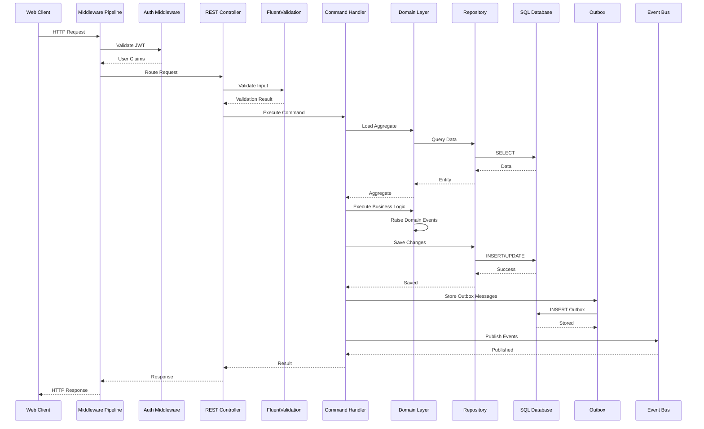
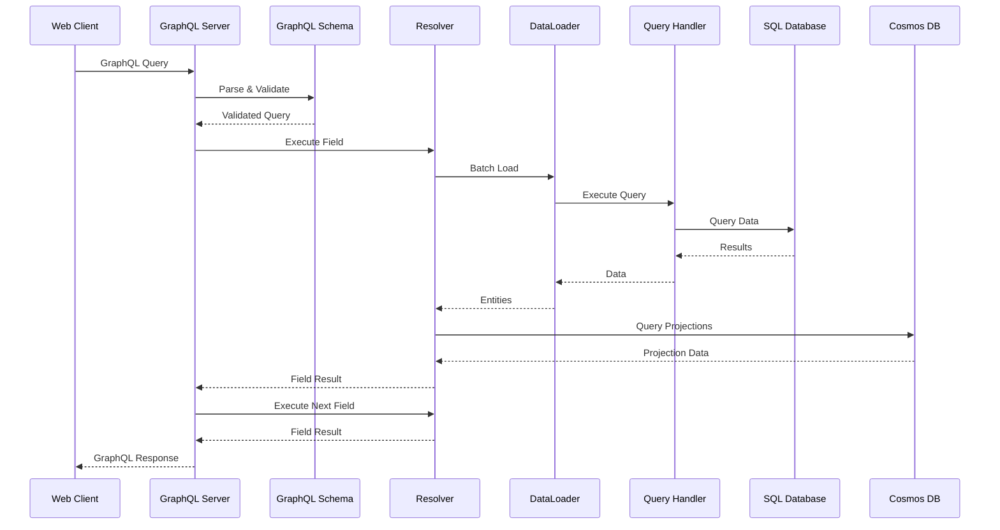
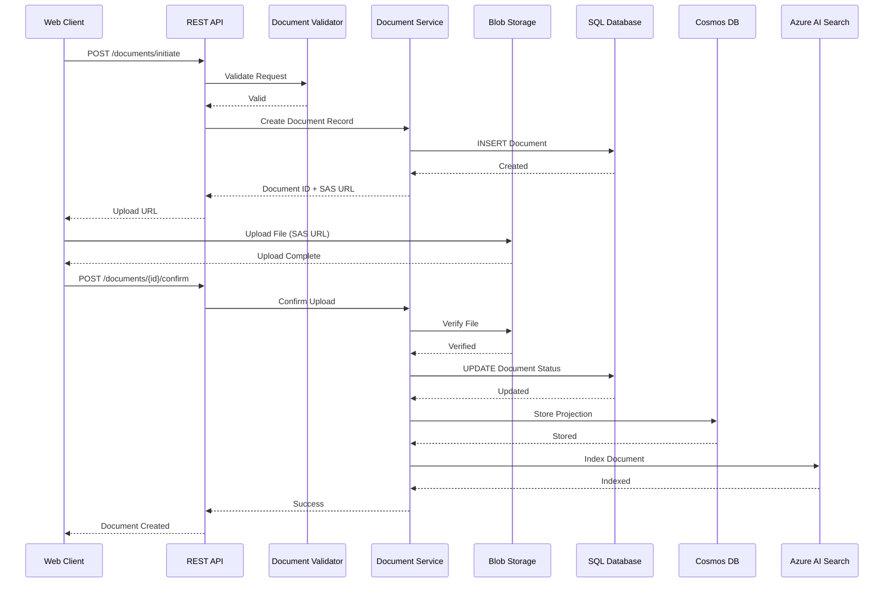
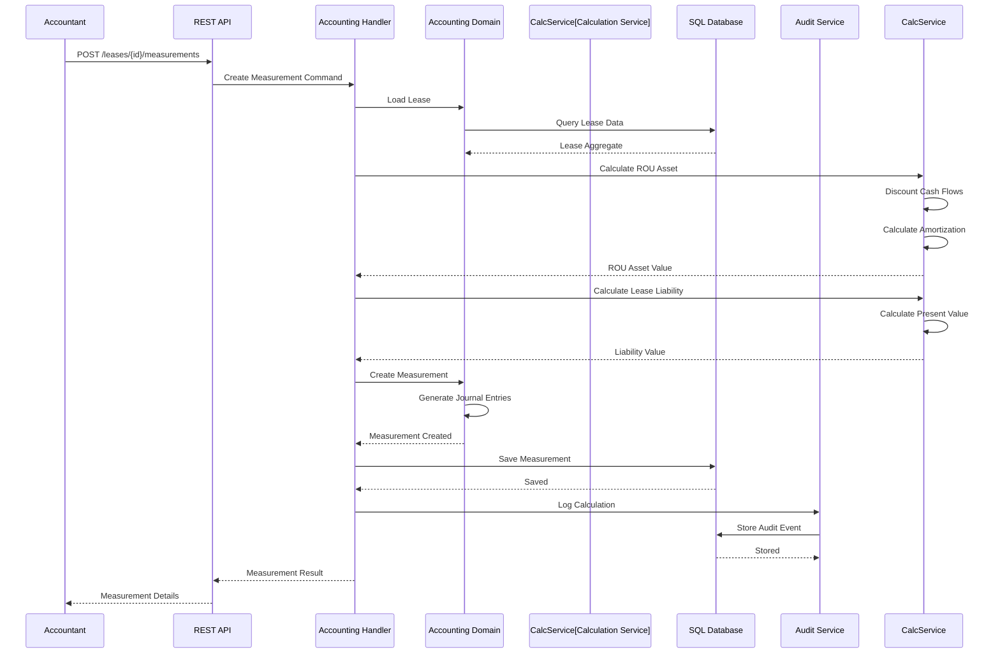
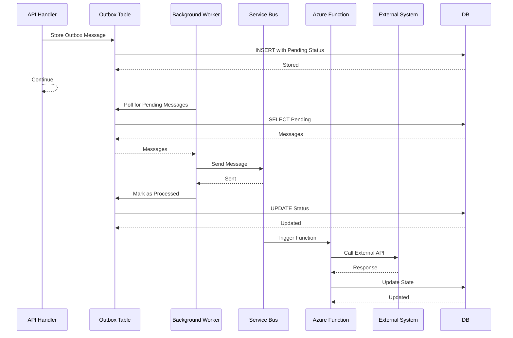
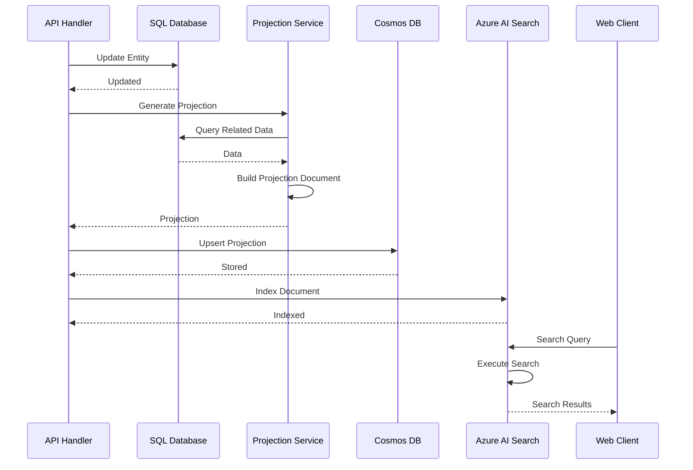

# Data Flow Diagrams

## REST API Request Flow

## GraphQL Query Flow

## Document Upload Flow

## Lease Accounting Calculation Flow

## Event-Driven Background Processing Flow

## Search Indexing Flow

