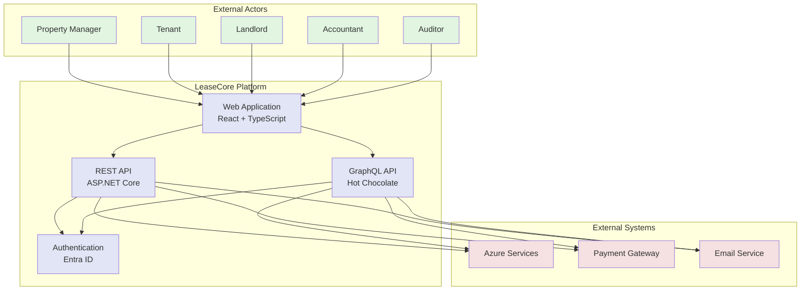

# System Context Diagram

## System Overview

The LeaseCore platform serves multiple external actors through a unified web application interface:

### External Actors

- **Property Manager**: Manages portfolios, properties, and leases
- **Tenant**: Views lease information, obligations, and documents
- **Landlord**: Reviews property performance and lease terms
- **Accountant**: Handles lease accounting and financial reporting
- **Auditor**: Audits compliance and financial records

### Core Components

- **Web Application**: React + TypeScript frontend providing user interface
- **REST API**: ASP.NET Core Web API for resource operations
- **GraphQL API**: Hot Chocolate for complex data queries
- **Authentication**: Microsoft Entra ID for identity and access management

### External Integrations

- **Azure Services**: SQL, Cosmos DB, Blob Storage, Functions, Service Bus
- **Payment Gateway**: For rent payment processing
- **Email Service**: For notifications and reminders
