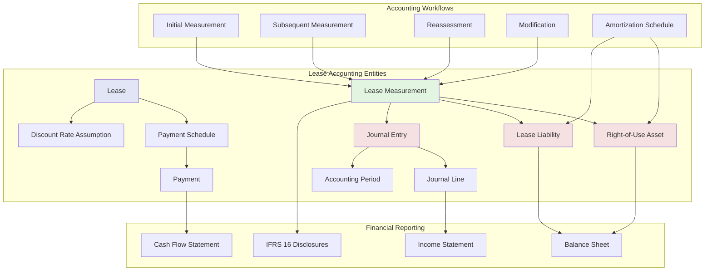

# Lease Accounting Domain (IFRS 16)

## IFRS 16 Accounting Concepts

### Lease Measurement

The process of calculating the initial and subsequent recognition of lease assets and liabilities:

1. **Initial Measurement**
   - Calculate present value of lease payments
   - Determine right-of-use (ROU) asset value
   - Recognize lease liability

2. **Subsequent Measurement**
   - Amortize ROU asset over lease term
   - Accrue interest on lease liability
   - Adjust for remeasurement events

3. **Reassessment**
   - Reassess lease term
   - Reassess purchase option
   - Reassess residual value guarantee

4. **Modification**
   - Change in lease scope
   - Change in lease consideration
   - Remasurement of asset and liability

### Key Entities

#### Payment Schedule
- Fixed lease payments
- Variable lease payments
- Residual value guarantees
- Purchase options
- Termination penalties

#### Discount Rate Assumption
- Incremental borrowing rate
- Rate implicit in lease
- Currency-specific rates
- Effective date of rate

#### Right-of-Use Asset
- Initial recognition amount
- Lease incentives received
- Direct costs incurred
- Estimated dismantling costs
- Accumulated amortization
- Carrying amount

#### Lease Liability
- Present value of lease payments
- Initial recognition amount
- Interest expense accrued
- Lease payments made
- Carrying amount

#### Journal Entry
- Debit/credit amounts
- Account codes
- Posting date
- Accounting period
- Reference to measurement
- Balancing validation

### Accounting Periods

Accounting periods track financial reporting timeframes:
- Monthly, quarterly, annual periods
- Period closing process
- Period locking
- Audit trail

### Journal Structure

Each journal entry must balance:
- Total debits = Total credits
- Currency-specific balancing
- Multi-currency support
- Audit trail for all entries

## IFRS 16 Disclosure Requirements

The platform must support IFRS 16 disclosure reporting:

1. **Balance Sheet Disclosures**
   - ROU asset carrying amounts
   - Lease liability carrying amounts
   - Maturity analysis of liabilities

2. **Income Statement Disclosures**
   - Depreciation expense
   - Interest expense
   - Variable lease payments
   - Short-term lease expenses

3. **Cash Flow Disclosures**
   - Cash payments for lease liabilities
   - Cash payments for short-term leases
   - Cash payments for variable lease payments

4. **Qualitative Disclosures**
   - Lease term analysis
   - Significant judgments and estimates
   - Maturity analysis
