# Bounded Contexts

```mermaid
flowchart TB
    subgraph "Identity & Tenancy Context"
        Identity[Identity Module]
        Org[Organisation]
        Tenant[Tenant]
        User[User]
        Role[Role]
        Permission[Permission]
        Membership[Membership]
    end

    subgraph "Portfolio Context"
        Portfolio[Portfolio Module]
        PortfolioEntity[Portfolio]
        Property[Property]
        Building[Building]
        Unit[Unit]
        Ownership[Ownership Interest]
    end

    subgraph "Lease Management Context"
        Leases[Leases Module]
        Lease[Lease]
        LeaseParty[Lease Party]
        LeaseTerm[Lease Term]
        Amendment[Lease Amendment]
        RentSchedule[Rent Schedule]
        RentReview[Rent Review]
        LeaseOption[Lease Option]
    end

    subgraph "Documents Context"
        Documents[Documents Module]
        Document[Document]
        DocumentVersion[Document Version]
        DocumentCategory[Document Category]
        StorageRef[Storage Reference]
    end

    subgraph "Obligations Context"
        Obligations[Obligations Module]
        KeyDate[Key Date]
        Obligation[Obligation]
        Reminder[Reminder]
        Notification[Notification]
    end

    subgraph "Work Management Context"
        Work[Work Management Module]
        Task[Task]
        Assignment[Task Assignment]
        Priority[Priority]
        Status[Status]
    end

    subgraph "Accounting Context"
        Accounting[Accounting Module]
        PaymentSchedule[Payment Schedule]
        Measurement[Lease Measurement]
        ROUAsset[Right-of-Use Asset]
        Liability[Lease Liability]
        Journal[Journal Entry]
        JournalLine[Journal Line]
    end

    subgraph "Search Context"
        Search[Search Module]
        SearchProjection[Search Projection]
        ReadModel[Read Model]
    end

    subgraph "Audit Context"
        Audit[Audit Module]
        AuditEvent[Audit Event]
        SecurityEvent[Security Event]
    end

    Identity --> Portfolio
    Identity --> Leases
    Identity --> Documents
    Identity --> Obligations
    Identity --> Work
    Identity --> Accounting
    Identity --> Search
    Identity --> Audit

    Portfolio --> Leases
    Portfolio --> Documents
    Portfolio --> Obligations
    Portfolio --> Work
    Portfolio --> Accounting
    Portfolio --> Search

    Leases --> Documents
    Leases --> Obligations
    Leases --> Work
    Leases --> Accounting
    Leases --> Search
    Leases --> Audit

    Documents --> Search
    Documents --> Audit

    Obligations --> Work
    Obligations --> Search
    Obligations --> Audit

    Work --> Search
    Work --> Audit

    Accounting --> Search
    Accounting --> Audit

    style Identity fill:#e1e5f5
    style Portfolio fill:#e1f5e1
    style Leases fill:#e1f5e1
    style Documents fill:#e1f5e1
    style Obligations fill:#e1f5e1
    style Work fill:#e1f5e1
    style Accounting fill:#e1f5e1
    style Search fill:#f5e1e1
    style Audit fill:#f5e1e1
```

## Context Overview

### Identity & Tenancy Context
Manages organisations, users, roles, permissions, and multi-tenancy. Provides authentication and authorization services to all other contexts.

### Portfolio Context
Manages the physical property hierarchy: organisations, portfolios, properties, buildings, units, and ownership interests.

### Lease Management Context
Core business context managing lease agreements, parties, terms, amendments, rent schedules, reviews, and options.

### Documents Context
Manages document metadata, versions, categories, and storage references. Integrates with Blob Storage for file storage.

### Obligations Context
Manages key dates, contractual obligations, reminders, and notifications derived from lease terms.

### Work Management Context
Manages tasks, assignments, priorities, and status tracking for operational workflows.

### Accounting Context
Manages lease accounting including payment schedules, IFRS 16 measurements, right-of-use assets, lease liabilities, and journal entries.

### Search Context
Provides search projections and read models optimized for querying across multiple bounded contexts.

### Audit Context
Captures security and business audit events for compliance and traceability.

## Context Relationships

- **Identity** is the foundation for all contexts, providing tenant isolation and user authorization
- **Portfolio** provides the property structure that **Leases** reference
- **Leases** is the central context that drives **Documents**, **Obligations**, **Work**, and **Accounting**
- **Search** aggregates data from multiple contexts for reporting and discovery
- **Audit** records important events from all contexts for compliance
