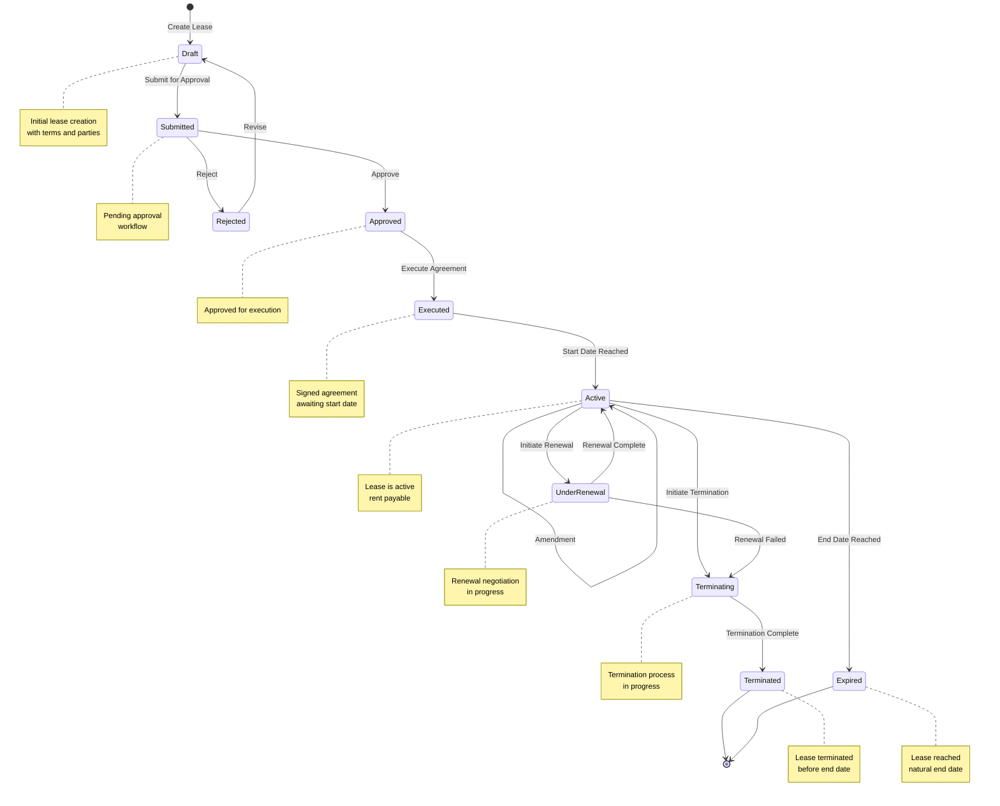

# Lease Lifecycle

## Lease Status Transitions

### Draft
- Initial state when a lease is created
- Contains all lease terms, parties, and conditions
- Can be edited and revised before submission

### Submitted
- Lease submitted for approval workflow
- Cannot be modified without rejection
- Pending review by authorized personnel

### Approved
- Lease approved for execution
- Cannot be modified
- Ready for signature

### Rejected
- Lease rejected during approval
- Returns to Draft for revisions
- Can be resubmitted after changes

### Executed
- Lease has been signed by all parties
- Awaiting lease start date
- All terms are finalized

### Active
- Lease is currently in effect
- Rent payments are due
- Obligations are active
- Can undergo rent reviews and amendments
- Can be renewed or terminated

### Under Renewal
- Renewal process initiated
- Negotiation in progress
- Can return to Active if renewed
- Can move to Terminating if renewal fails

### Terminating
- Termination process initiated
- Notice period active
- Final obligations being settled
- Moves to Terminated when complete

### Terminated
- Lease terminated before natural end date
- All obligations settled
- No further activity

### Expired
- Lease reached natural end date
- All obligations completed
- No further activity

## Lease Lifecycle Events

| Event | Trigger | Impact |
|-------|---------|--------|
| Lease Created | User creates new lease | Status: Draft |
| Lease Submitted | User submits for approval | Status: Submitted |
| Lease Approved | Approver approves lease | Status: Approved |
| Lease Rejected | Approver rejects lease | Status: Rejected |
| Lease Executed | All parties sign | Status: Executed |
| Lease Started | Start date reached | Status: Active |
| Rent Review | Review date reached | Status: Active (updated terms) |
| Amendment Executed | Amendment signed | Status: Active (updated terms) |
| Renewal Initiated | Renewal notice sent | Status: UnderRenewal |
| Renewal Completed | Renewal agreement signed | Status: Active |
| Termination Initiated | Termination notice sent | Status: Terminating |
| Termination Completed | Termination date reached | Status: Terminated |
| Lease Expired | End date reached | Status: Expired |
