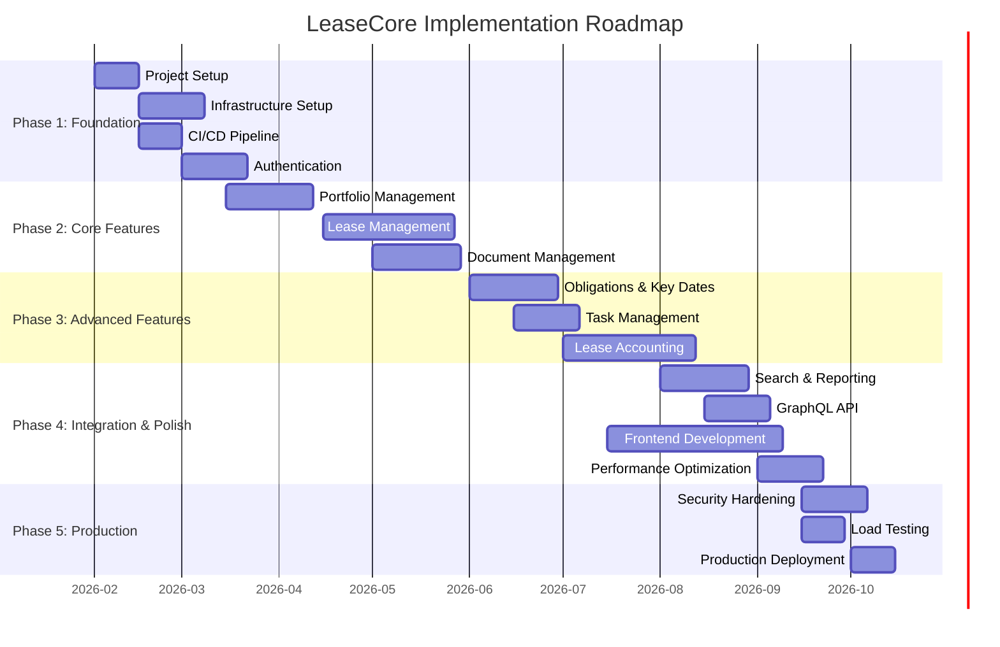
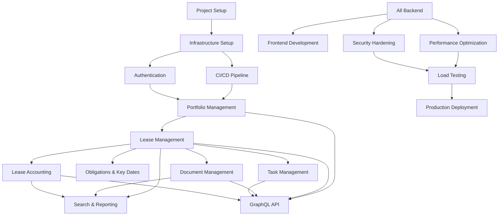

# Implementation Roadmap

## Overview

This document outlines the implementation roadmap for the LeaseCore platform, organized by phases and milestones.

## Phases Overview

## Phase 1: Foundation (February - March 2026)

### Milestone 1.1: Project Setup

**Duration:** 2 weeks
**Deliverables:**
- Solution structure configured
- Building blocks projects created
- Module projects created
- Test projects created
- .editorconfig and coding standards
- Git repository initialized

**Acceptance Criteria:**
- [ ] Solution builds successfully
- [ ] All projects reference correct NuGet packages
- [ ] Code style rules enforced
- [ ] Git workflow documented

### Milestone 1.2: Infrastructure Setup

**Duration:** 3 weeks
**Deliverables:**
- Azure resource group created
- Azure SQL Database provisioned
- Cosmos DB account provisioned
- Blob Storage account provisioned
- Key Vault provisioned
- Application Insights provisioned
- Infrastructure as code (Bicep/Terraform)

**Acceptance Criteria:**
- [ ] All Azure resources provisioned
- [ ] Infrastructure reproducible via IaC
- [ ] Network security configured
- [ ] Managed identities configured
- [ ] Secrets stored in Key Vault

### Milestone 1.3: CI/CD Pipeline

**Duration:** 2 weeks
**Deliverables:**
- GitHub Actions workflow for CI
- GitHub Actions workflow for CD
- Automated testing in CI
- Automated deployment to staging
- Infrastructure validation

**Acceptance Criteria:**
- [ ] CI pipeline runs on every push
- [ ] All tests pass in CI
- [ ] CD pipeline deploys to staging
- [ ] Rollback procedure tested
- [ ] Pipeline documented

### Milestone 1.4: Authentication & Authorization

**Duration:** 3 weeks
**Deliverables:**
- Entra ID integration
- JWT token validation
- Role-based access control
- Tenant isolation
- User management API

**Acceptance Criteria:**
- [ ] Users can authenticate via Entra ID
- [ ] JWT tokens validated correctly
- [ ] Roles and permissions enforced
- [ ] Tenant isolation verified
- [ ] Authorization tests passing

## Phase 2: Core Features (March - May 2026)

### Milestone 2.1: Portfolio Management

**Duration:** 4 weeks
**Deliverables:**
- Portfolio CRUD operations
- Property CRUD operations
- Building CRUD operations
- Unit CRUD operations
- Ownership interest management
- REST API endpoints
- GraphQL schema

**Acceptance Criteria:**
- [ ] Portfolio hierarchy correctly modeled
- [ ] CRUD operations work correctly
- [ ] REST API functional
- [ ] GraphQL queries functional
- [ ] Data validation enforced
- [ ] Unit tests passing
- [ ] Integration tests passing

### Milestone 2.2: Lease Management

**Duration:** 6 weeks
**Deliverables:**
- Lease CRUD operations
- Lease party management
- Lease term management
- Lease amendment workflow
- Rent schedule management
- Rent review management
- Lease options management
- Lease lifecycle state machine
- REST API endpoints
- GraphQL schema

**Acceptance Criteria:**
- [ ] Lease lifecycle correctly implemented
- [ ] State transitions validated
- [ ] Amendments preserve history
- [ ] Rent schedules calculated correctly
- [ ] REST API functional
- [ ] GraphQL queries functional
- [ ] Domain tests passing
- [ ] Integration tests passing

### Milestone 2.3: Document Management

**Duration:** 4 weeks
**Deliverables:**
- Document metadata management
- Document versioning
- Document upload workflow
- Document download workflow
- Document access grants
- Blob Storage integration
- REST API endpoints
- GraphQL schema

**Acceptance Criteria:**
- [ ] Documents upload and download correctly
- [ ] Document versions immutable
- [ ] Access grants enforced
- [ ] File validation working
- [ ] Virus scanning integrated
- [ ] REST API functional
- [ ] GraphQL queries functional
- [ ] Integration tests passing

## Phase 3: Advanced Features (June - July 2026)

### Milestone 3.1: Obligations & Key Dates

**Duration:** 4 weeks
**Deliverables:**
- Key date management
- Obligation management
- Reminder system
- Notification delivery
- Email integration
- REST API endpoints

**Acceptance Criteria:**
- [ ] Key dates derived from lease terms
- [ ] Reminders triggered correctly
- [ ] Notifications delivered
- [ ] Email integration working
- [ ] REST API functional
- [ ] Unit tests passing
- [ ] Integration tests passing

### Milestone 3.2: Task Management

**Duration:** 3 weeks
**Deliverables:**
- Task CRUD operations
- Task assignment
- Task status workflow
- Task escalation
- Priority management
- REST API endpoints
- GraphQL schema

**Acceptance Criteria:**
- [ ] Tasks created and assigned correctly
- [ ] Status transitions validated
- [ ] Escalation logic working
- [ ] REST API functional
- [ ] GraphQL queries functional
- [ ] Unit tests passing
- [ ] Integration tests passing

### Milestone 3.3: Lease Accounting

**Duration:** 6 weeks
**Deliverables:**
- Payment schedule management
- Discount rate assumptions
- Lease measurement calculations
- Right-of-use asset calculations
- Lease liability calculations
- Journal entry generation
- Accounting period management
- IFRS 16 reporting
- REST API endpoints

**Acceptance Criteria:**
- [ ] Payment schedules generated correctly
- [ ] Measurements calculated accurately
- [ ] ROU asset values correct
- [ ] Lease liability values correct
- [ ] Journal entries balance
- [ ] IFRS 16 reports generated
- [ ] REST API functional
- [ ] Unit tests passing
- [ ] Integration tests passing

## Phase 4: Integration & Polish (July - September 2026)

### Milestone 4.1: Search & Reporting

**Duration:** 4 weeks
**Deliverables:**
- Azure AI Search integration
- Search projections
- Lease expiration report
- Rent roll report
- Portfolio summary report
- REST API endpoints

**Acceptance Criteria:**
- [ ] Search returns relevant results
- [ ] Search performance acceptable
- [ ] Reports generated correctly
- [ ] Reports exportable
- [ ] REST API functional
- [ ] Integration tests passing

### Milestone 4.2: GraphQL API

**Duration:** 3 weeks
**Deliverables:**
- Complete GraphQL schema
- Query resolvers
- Mutation resolvers
- DataLoaders for N+1 prevention
- Query complexity limits
- Query depth limits
- Authorization directives
- Scalar integration

**Acceptance Criteria:**
- [ ] GraphQL schema complete
- [ ] All queries functional
- [ ] All mutations functional
- [ ] N+1 queries prevented
- [ ] Complexity limits enforced
- [ ] Authorization enforced
- [ ] Contract tests passing

### Milestone 4.3: Frontend Development

**Duration:** 8 weeks (parallel with other milestones)
**Deliverables:**
- React application setup
- Authentication integration
- Portfolio management UI
- Lease management UI
- Document management UI
- Task management UI
- Accounting UI
- Reporting UI
- Responsive design

**Acceptance Criteria:**
- [ ] Frontend builds successfully
- [ ] Authentication flow working
- [ ] All CRUD operations functional in UI
- [ ] Responsive design verified
- [ ] E2E tests passing
- [ ] Accessibility verified

### Milestone 4.4: Performance Optimization

**Duration:** 3 weeks
**Deliverables:**
- Database query optimization
- Caching strategy implementation
- API response time optimization
- GraphQL query optimization
- Frontend performance optimization
- Load testing

**Acceptance Criteria:**
- [ ] API response time < 500ms (p95)
- [ ] Database queries optimized
- [ ] Caching effective
- [ ] GraphQL queries efficient
- [ ] Frontend load time < 3s
- [ ] Load test passes target metrics

## Phase 5: Production (September - October 2026)

### Milestone 5.1: Security Hardening

**Duration:** 3 weeks
**Deliverables:**
- Security audit
- Vulnerability remediation
- Penetration testing
- Security controls validation
- Compliance verification
- Documentation review

**Acceptance Criteria:**
- [ ] Security audit completed
- [ ] Critical vulnerabilities remediated
- [ ] Penetration test passed
- [ ] Security controls validated
- [ ] Compliance verified
- [ ] Security documentation complete

### Milestone 5.2: Load Testing

**Duration:** 2 weeks
**Deliverables:**
- Load test scenarios
- Performance baseline
- Stress testing
- Capacity planning
- Scalability validation

**Acceptance Criteria:**
- [ ] Load test scenarios defined
- [ ] Performance baseline established
- [ ] System handles target load
- [ ] Bottlenecks identified and addressed
- [ ] Scalability validated

### Milestone 5.3: Production Deployment

**Duration:** 2 weeks
**Deliverables:**
- Production environment setup
- Database migration to production
- Production deployment
- Smoke tests
- Monitoring and alerting setup
- Documentation handover
- Training

**Acceptance Criteria:**
- [ ] Production environment configured
- [ ] Data migrated successfully
- [ ] Application deployed
- [ ] Smoke tests passing
- [ ] Monitoring and alerting active
- [ ] Documentation complete
- [ ] Training completed

## Dependencies

## Risk Management

| Risk | Probability | Impact | Mitigation |
|------|-------------|--------|------------|
| Scope creep | Medium | High | Clear requirements, change control process |
| Technical debt | High | Medium | Code reviews, refactoring time |
| Third-party delays | Low | High | Vendor management, backup plans |
| Security vulnerabilities | Medium | High | Security testing, regular audits |
| Performance issues | Medium | Medium | Early performance testing, optimization |
| Resource constraints | Low | High | Resource planning, contingency budget |

## Success Metrics

| Metric | Target |
|--------|--------|
| On-time delivery | 90% of milestones |
| Budget adherence | Within 10% of budget |
| Code coverage | > 80% |
| API performance | < 500ms p95 |
| System availability | 99.9% |
| Security vulnerabilities | 0 critical, < 5 high |
| User satisfaction | > 4.5/5 |

## Milestone Tracking

Track milestone progress using the following format:

| Milestone | Status | Start Date | End Date | Progress | Notes |
|-----------|--------|------------|----------|-----------|-------|
| 1.1: Project Setup | ✅ Complete | 2026-02-01 | 2026-02-14 | 100% | |
| 1.2: Infrastructure Setup | 🔄 In Progress | 2026-02-15 | 2026-03-07 | 60% | Awaiting Azure approval |
| 1.3: CI/CD Pipeline | ⏳ Not Started | 2026-02-15 | 2026-02-28 | 0% | Blocked by 1.2 |
| 1.4: Authentication | ⏳ Not Started | 2026-03-01 | 2026-03-21 | 0% | |
| 2.1: Portfolio Management | ⏳ Not Started | 2026-03-15 | 2026-04-11 | 0% | |
| ... | ... | ... | ... | ... | ... |

**Status Legend:**
- ✅ Complete
- 🔄 In Progress
- ⏳ Not Started
- ⚠️ At Risk
- ❌ Blocked
