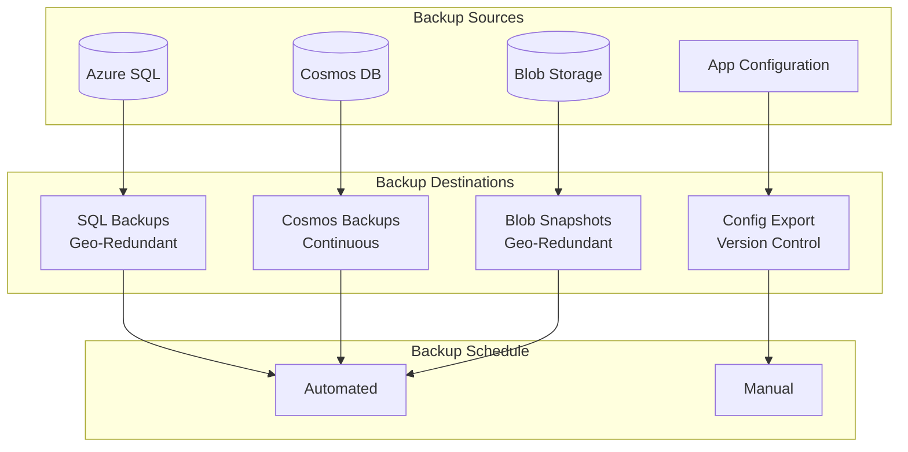
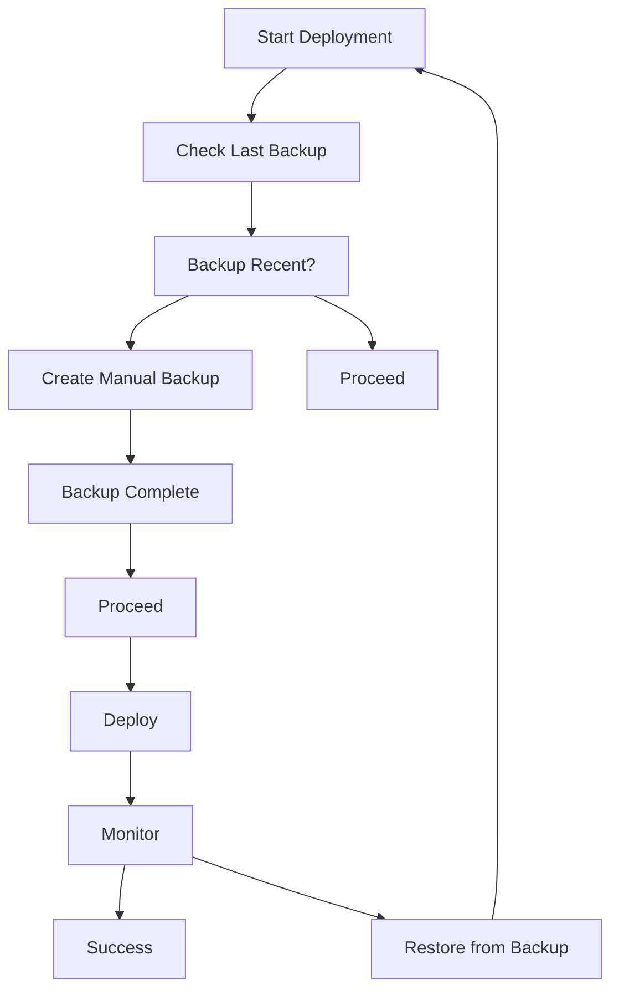

# Backup and Restore Procedures

## Overview

This document outlines the backup and restore procedures for the LeaseCore platform to ensure data protection and business continuity.

## Backup Strategy



## Backup Policies

### Azure SQL Database

| Backup Type | Frequency | Retention | Location |
|-------------|-----------|-----------|----------|
| Full Backup | Automatic | 7-35 days | Geo-redundant |
| Differential Backup | Automatic | 7-35 days | Geo-redundant |
| Transaction Log Backup | Automatic | 7-35 days | Geo-redundant |
| Long-term Retention | Weekly | 10 years | Azure Blob Storage |

**Configuration:**
- Point-in-time restore: 7-35 days (configurable)
- Geo-redundant backup storage
- Automatic backups enabled
- Backup retention: 35 days for production, 7 days for non-production

### Cosmos DB

| Backup Type | Frequency | Retention | Location |
|-------------|-----------|-----------|----------|
| Continuous Backup | Continuous | 30 days | Geo-redundant |
| On-demand Backup | Manual | 30 days | Geo-redundant |

**Configuration:**
- Continuous backup mode enabled
- 30-day retention period
- Automatic backup every 4 hours
- Geo-redundant storage

### Blob Storage

| Backup Type | Frequency | Retention | Location |
|-------------|-----------|-----------|----------|
| Object Replication | Continuous | N/A | Secondary Region |
| Blob Snapshots | Manual | 90 days | Same Region |
| Soft Delete | Automatic | 7 days | Same Region |

**Configuration:**
- Geo-redundant storage (GRS)
- Soft delete enabled (7 days)
- Versioning enabled
- Object replication to secondary region

### Application Configuration

| Component | Backup Method | Frequency | Location |
|-----------|---------------|-----------|----------|
| App Settings | Export to JSON | On change | Git Repository |
| Key Vault Secrets | Key Vault Backup | Monthly | Secure Storage |
| Connection Strings | Export (encrypted) | On change | Git Repository |

## Backup Procedures

### Automated Backups

Azure SQL and Cosmos DB backups are automated by Azure. No manual intervention required.

### Manual Backup Triggers

Manual backups should be triggered before:
- Major deployments
- Schema migrations
- Data migrations
- Configuration changes
- Risky operations

### Pre-Deployment Backup Procedure



**Steps:**

1. **SQL Database:**
   ```bash
   # Trigger manual backup via Azure Portal or CLI
   az sql db copy \
     --source-server source-server \
     --source-db source-db \
     --dest-server dest-server \
     --dest-db backup-db
   ```

2. **Cosmos DB:**
   ```bash
   # Trigger on-demand backup via Azure Portal
   # Or use Azure CLI
   az cosmosdb backup trigger \
     --account-name account-name \
     --resource-group resource-group
   ```

3. **Blob Storage:**
   ```bash
   # Create blob snapshot
   az storage blob snapshot \
     --container-name container \
     --name blob-name
   ```

4. **Key Vault:**
   ```bash
   # Backup Key Vault secrets
   az keyvault secret backup \
     --vault-name vault-name \
     --name secret-name \
     --file backup-file
   ```

## Restore Procedures

### SQL Database Restore

#### Point-in-Time Restore

**Use Case:** Restore to a specific point in time within retention period

**Procedure:**

1. Navigate to Azure SQL Database in Azure Portal
2. Select "Restore" from the menu
3. Choose "Point-in-time restore"
4. Select point-in-time (within retention period)
5. Specify target database name
6. Select target server
6. Click "Restore"

**CLI Command:**
```bash
az sql db restore \
  --dest-server target-server \
  --dest-db restored-db \
  --source-server source-server \
  --source-db source-db \
  --time "2026-01-15T10:30:00Z"
```

#### Geo-Restore

**Use Case:** Restore from geo-redundant backup in different region

**Procedure:**

1. Navigate to Azure SQL Database in Azure Portal
2. Select "Restore" from the menu
3. Choose "Geo-restore"
4. Select source database and region
5. Specify target database name and region
6. Click "Restore"

#### Long-term Retention Restore

**Use Case:** Restore from long-term retention backup (older than 35 days)

**Procedure:**

1. Navigate to Azure SQL Database in Azure Portal
2. Select "Long-term retention backup"
3. Select backup to restore
4. Specify target database name
5. Click "Restore"

### Cosmos DB Restore

#### Restore from Continuous Backup

**Use Case:** Restore to any point in time within retention period

**Procedure:**

1. Navigate to Cosmos DB account in Azure Portal
2. Select "Data Explorer" -> "Restore"
3. Select source account/database
4. Specify point-in-time
5. Specify target account/database
6. Click "Submit"

**CLI Command:**
```bash
az cosmosdb database restore \
  --account-name source-account \
  --database-name source-db \
  --restore-timestamp "2026-01-15T10:30:00Z" \
  --dest-account-name target-account \
  --dest-database-name restored-db
```

### Blob Storage Restore

#### Restore from Snapshot

**Use Case:** Restore a blob to a previous snapshot version

**Procedure:**

1. Navigate to Blob Storage in Azure Portal
2. Select blob
3. View snapshots
4. Copy snapshot to restore
5. Overwrite original blob if needed

**CLI Command:**
```bash
az storage blob copy start \
  --source-container container \
  --source-blob blob-name \
  --source-snapshot snapshot \
  --dest-container container \
  --dest-blob blob-name
```

#### Restore from Soft Delete

**Use Case:** Restore accidentally deleted blob within soft delete period

**Procedure:**

1. Navigate to Blob Storage in Azure Portal
2. Enable "Show deleted blobs"
3. Select deleted blob
4. Click "Undelete"

**CLI Command:**
```bash
az storage blob undelete \
  --container-name container \
  --name blob-name
```

### Key Vault Restore

#### Restore Secrets

**Use Case:** Restore Key Vault secrets from backup

**Procedure:**

1. Navigate to Key Vault in Azure Portal
2. Select "Secrets" -> "Restore"
3. Upload backup file
4. Confirm restore

**CLI Command:**
```bash
az keyvault secret restore \
  --vault-name vault-name \
  --file backup-file
```

## Disaster Recovery Scenarios

### Scenario 1: Accidental Data Deletion

**Symptoms:** User accidentally deleted important data

**Procedure:**

1. Identify time of deletion
2. Restore database to point-in-time before deletion
3. Export deleted data from restored database
4. Import data into production database
5. Verify data integrity
6. Document incident

### Scenario 2: Data Corruption

**Symptoms:** Data integrity issues detected

**Procedure:**

1. Identify time of corruption
2. Restore database to point-in-time before corruption
3. Switch application to restored database
4. Investigate root cause
5. Fix corruption issue
6. Re-apply changes after corruption point

### Scenario 3: Regional Outage

**Symptoms:** Primary region unavailable

**Procedure:**

1. Activate DR plan
2. Failover to secondary region
3. Verify data integrity in secondary region
4. Update DNS to point to secondary region
5. Monitor application health
6. When primary region recovers, failback

### Scenario 4: Ransomware Attack

**Symptoms:** Data encrypted by malware

**Procedure:**

1. **Immediate:**
   - Isolate affected systems
   - Shut down access to prevent spread
   - Disconnect from network

2. **Assessment:**
   - Identify scope of attack
   - Determine which systems affected
   - Assess data loss

3. **Recovery:**
   - Restore from clean backups
   - Verify backups are not compromised
   - Restore to point-in-time before attack
   - Change all credentials

4. **Post-Recovery:**
   - Scan systems for malware
   - Patch vulnerabilities
   - Implement additional security measures
   - Document incident

## Backup Verification

### Automated Verification

- **Daily:** Automated checks verify backup existence
- **Weekly:** Automated integrity checks on recent backups
- **Monthly:** Automated restore test to test environment

### Manual Verification

- **Quarterly:** Full restore test to staging environment
- **Annually:** Full disaster recovery drill

### Verification Checklist

- [ ] Backup completed successfully
- [ ] Backup file exists
- [ ] Backup file integrity verified
- [ ] Restore test successful
- [ ] Data integrity verified
- [ ] Application functions correctly with restored data

## Backup Metrics

### Key Metrics to Track

| Metric | Target | Alert Threshold |
|--------|--------|-----------------|
| Backup Success Rate | 100% | < 99% |
| Backup Duration | < 1 hour | > 2 hours |
| Restore Duration | < 4 hours | > 8 hours |
| Backup Storage Cost | Within budget | > 110% budget |
| Data Loss (RPO) | < 15 minutes | > 15 minutes |
| Recovery Time (RTO) | < 4 hours | > 8 hours |

## Backup Retention Policy

| Data Type | Retention Period | Reason |
|-----------|------------------|--------|
| Production Database | 35 days | Operational recovery |
| Long-term Database | 10 years | Compliance |
| Cosmos DB | 30 days | Operational recovery |
| Documents | 90 days | Operational recovery |
| Audit Logs | 7 years | Compliance |
| Configuration | Indefinite (Git) | Version control |

## Security Considerations

### Backup Encryption

- All backups encrypted at rest
- Backup encryption keys stored in Key Vault
- Separate encryption keys for each environment

### Backup Access Control

- Backup access restricted to authorized personnel
- Audit logging for all backup/restore operations
- Multi-factor authentication required for restore operations

### Backup Isolation

- Backups stored in separate subscription/region
- Access to backups requires separate authorization
- Regular review of backup access permissions

## Documentation

### Backup Log

Maintain a log of all backup and restore operations:

| Date | Operation | Type | Status | Performed By | Notes |
|------|-----------|------|--------|--------------|-------|
| 2026-01-15 | Manual Backup | SQL | Success | John Doe | Pre-deployment |
| 2026-01-20 | Restore | SQL | Success | Jane Smith | Incident #123 |

### Procedure Updates

Review and update this document:
- **Annually** or after any major infrastructure change
- After any backup/restore incident
- After any DR drill

## Contact Information

| Role | Contact | Responsibility |
|------|---------|----------------|
| Database Administrator | dba@leasecore.com | Database backup/restore |
| DevOps Engineer | devops@leasecore.com | Infrastructure backup/restore |
| Security Engineer | security@leasecore.com | Backup security |
| Incident Commander | incident@leasecore.com | DR coordination |
