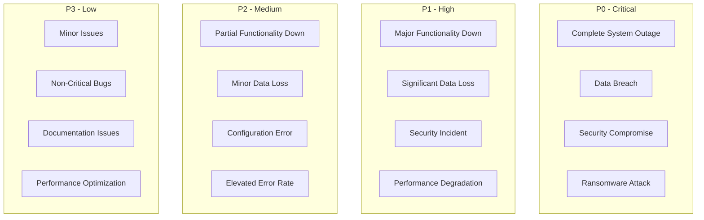
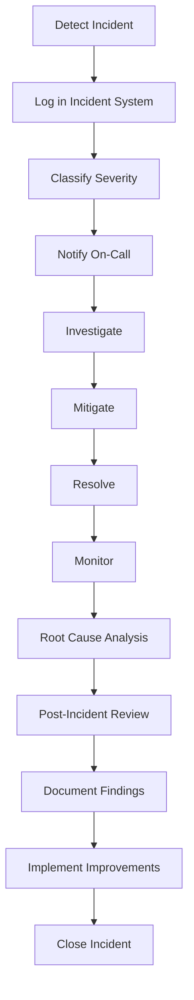

# Incident Response Plan

## Overview

This document outlines the incident response plan for the LeaseCore platform, including procedures for detecting, responding to, and recovering from security incidents and operational outages.

## Incident Classification

### Severity Levels



| Severity | Definition | Response Time | Escalation |
|----------|------------|---------------|------------|
| **P0 - Critical** | System down, data breach, security compromise | 15 minutes | Immediate executive notification |
| **P1 - High** | Major functionality unavailable, significant data loss | 1 hour | Team lead notification |
| **P2 - Medium** | Partial functionality unavailable, minor data loss | 4 hours | Manager notification |
| **P3 - Low** | Minor issues, workarounds available | 24 hours | Team notification |

## Incident Response Process



## Incident Response Team

### Roles and Responsibilities

| Role | Primary | Backup | Responsibilities |
|------|---------|--------|------------------|
| **Incident Commander** | John Doe | Jane Smith | Overall coordination, communication, decision making |
| **Security Engineer** | Mike Johnson | Sarah Lee | Security investigation, forensic analysis |
| **DevOps Engineer** | Tom Wilson | Alice Brown | System recovery, infrastructure fixes |
| **Database Administrator** | Bob Davis | Carol White | Database recovery, data integrity |
| **Application Developer** | David Miller | Emma Taylor | Code fixes, application debugging |
| **Legal/Compliance** | Legal Team | - | Regulatory requirements, legal review |
| **Communications** | PR Team | - | Stakeholder communication, public statements |

### On-Call Rotation

- **Primary:** Available 24/7 via phone, Slack, email
- **Secondary:** Backup if primary unavailable
- **Escalation:** Manager if no response within 15 minutes

## Detection Procedures

### Automated Detection

**Monitoring Alerts:**

| Alert Type | Severity | Auto-Response |
|------------|----------|---------------|
| CPU > 95% | P2 | Scale out |
| Memory > 95% | P2 | Scale out |
| Error rate > 5% | P1 | Page on-call |
| Database connection failure | P0 | Page on-call |
| API latency > 2s | P2 | Log alert |
| Failed authentication > 10/min | P1 | Page on-call |
| Unauthorized access attempt | P1 | Page on-call |
| Data loss detected | P0 | Page on-call |

### Manual Detection

**Report Channels:**

- User reports via support email
- Internal reports via Slack #incidents
- External reports via security@leasecore.com
- Third-party monitoring services

## Response Procedures

### P0 Incident Response (Critical)

**Timeline:**

```mermaid
gantt
    title P0 Incident Response Timeline
    dateFormat HH:mm
    axisFormat %H:%M

    section Detection
    Detect Incident :0, 15m
    Log Incident :15, 5m

    section Initial Response
    Notify On-Call :20, 5m
    Assemble Team :25, 15m
    Initial Assessment :40, 20m

    section Investigation
    Investigate Root Cause :60, 30m
    Identify Mitigation :90, 15m

    section Mitigation
    Implement Mitigation :105, 30m
    Verify Fix :135, 15m

    section Recovery
    Monitor Stability :150, 30m
    Document Findings :180, 30m
```

**0-15 Minutes: Detection & Initial Response**

1. **Incident Commander:**
   - Acknowledge alert
   - Create incident ticket
   - Begin initial assessment
   - Notify on-call team

2. **Notifications:**
   - Page all on-call team members
   - Notify executive team
   - Update status page

**15-60 Minutes: Investigation**

1. **Investigation:**
   - Check health endpoints
   - Review error logs
   - Check recent deployments
   - Review metrics
   - Identify scope of impact

2. **Assessment:**
   - Determine root cause (if possible)
   - Identify affected services
   - Estimate user impact
   - Determine mitigation strategy

**60-120 Minutes: Mitigation**

1. **Immediate Actions:**
   - Implement temporary fix
   - Rollback if recent deployment
   - Scale out if resource issue
   - Block malicious IPs if security issue
   - Isolate affected systems

2. **Verification:**
   - Verify fix is working
   - Monitor error rates
   - Check health endpoints
   - Confirm service restoration

**120+ Minutes: Recovery**

1. **Stabilization:**
   - Monitor for recurrence
   - Implement permanent fix
   - Verify data integrity
   - Restore from backup if needed

2. **Communication:**
   - Update stakeholders
   - Post incident summary
   - Update status page

### P1 Incident Response (High)

**Timeline:**

```mermaid
gantt
    title P1 Incident Response Timeline
    dateFormat HH:mm
    axisFormat %H:%M

    section Detection
    Detect Incident :0, 30m
    Log Incident :30, 10m

    section Initial Response
    Notify On-Call :40, 10m
    Initial Assessment :50, 30m

    section Investigation
    Investigate Root Cause :80, 60m
    Identify Mitigation :140, 15m

    section Mitigation
    Implement Mitigation :155, 45m
    Verify Fix :200, 15m

    section Recovery
    Monitor Stability :215, 45m
    Document Findings :260, 30m
```

**Procedure:**

1. **0-30 Minutes:** Detect and log incident
2. **30-60 Minutes:** Notify on-call, initial assessment
3. **60-120 Minutes:** Investigation
4. **120-180 Minutes:** Mitigation
5. **180+ Minutes:** Recovery and monitoring

### P2 Incident Response (Medium)

**Timeline:**

- **Response Time:** 4 hours
- **Resolution Time:** 24 hours

**Procedure:**

1. Detect and log incident
2. Notify team via Slack
3. Investigation during business hours
4. Implement fix within 24 hours
5. Monitor for recurrence

### P3 Incident Response (Low)

**Timeline:**

- **Response Time:** 24 hours
- **Resolution Time:** 7 days

**Procedure:**

1. Detect and log incident
2. Add to backlog
3. Address in next sprint
4. Monitor impact

## Communication Procedures

### Internal Communication

**Channels:**

- **#incidents** (Slack): Real-time incident updates
- **#incidents-summary** (Slack): Post-incident summaries
- **Email:** Formal notifications for stakeholders

**Template:**

```
🚨 INCIDENT ALERT

Severity: P0 / P1 / P2 / P3
Service: [Service Name]
Impact: [Description of impact]
Status: [Investigating / Mitigating / Resolved]
Timeline:
- [Time]: [Event]
- [Time]: [Event]
Next Update: [Time]
Incident Commander: [@name]
```

### External Communication

**Stakeholders:**

- **Customers:** Status page, email notifications
- **Management:** Executive briefings
- **Public:** Social media, press releases (if major incident)

**Status Page:**

- Update within 15 minutes of P0/P1 incident
- Update every 30 minutes during incident
- Final update within 24 hours of resolution

### Regulatory Notification

**GDPR Breach Notification:**

- Notify within 72 hours of discovery
- Include description, categories of data, affected individuals
- Document mitigation measures

## Common Incident Scenarios

### Scenario 1: Complete Service Outage

**Detection:**
- Health endpoint failures
- User reports
- Monitoring alerts

**Investigation:**
- Check Azure status
- Check application logs
- Check recent deployments
- Check DNS configuration

**Mitigation:**
- Rollback recent deployment if applicable
- Scale out resources
- Restart services
- Failover to secondary region if needed

**Recovery:**
- Monitor health endpoints
- Verify functionality
- Update status page
- Document root cause

### Scenario 2: Data Breach

**Detection:**
- Security alerts
- User reports of unauthorized access
- Anomaly detection

**Investigation:**
- Identify scope of breach
- Determine data accessed
- Identify attacker if possible
- Check for persistence mechanisms

**Mitigation:**
- Isolate affected systems
- Revoke compromised credentials
- Block malicious IPs
- Patch vulnerabilities

**Recovery:**
- Restore from clean backups
- Change all credentials
- Implement additional security measures
- Notify affected parties
- Report to regulatory bodies

### Scenario 3: Database Corruption

**Detection:**
- Database errors
- Data integrity checks
- User reports of incorrect data

**Investigation:**
- Identify corrupted data
- Determine cause (hardware, software, human error)
- Assess extent of corruption

**Mitigation:**
- Restore from backup
- Switch to read-only mode if needed
- Disable affected features

**Recovery:**
- Verify data integrity
- Re-apply transactions after corruption point
- Monitor for recurrence

### Scenario 4: Security Vulnerability

**Detection:**
- External disclosure
- Internal security scan
- CVE notification

**Investigation:**
- Assess vulnerability severity
- Determine if exploited
- Identify affected systems

**Mitigation:**
- Apply security patch
- Implement workaround if patch unavailable
- Disable vulnerable feature

**Recovery:**
- Verify patch effectiveness
- Monitor for exploitation attempts
- Update security documentation

## Post-Incident Activities

### Root Cause Analysis (RCA)

**Timeline:** Within 7 days of incident resolution

**Template:**

```
Incident #: [Number]
Date: [Date]
Severity: [P0/P1/P2/P3]

1. What happened?
   [Timeline of events]

2. Why did it happen?
   [Root cause analysis]

3. What did we do?
   [Actions taken]

4. What did we learn?
   [Lessons learned]

5. What will we do differently?
   [Action items with owners and due dates]
```

### Post-Incident Review (PIR)

**Participants:** Incident response team, stakeholders

**Agenda:**

1. Timeline review
2. What went well
3. What didn't go well
4. Root cause analysis
5. Action items
6. Process improvements

### Action Items

| Item | Owner | Due Date | Status |
|------|-------|----------|--------|
| [Action item] | [Name] | [Date] | [Open/Closed] |

## Incident Metrics

### Key Metrics to Track

| Metric | Target | Current |
|--------|--------|---------|
| Mean Time to Detect (MTTD) | < 15 minutes | TBD |
| Mean Time to Respond (MTTR) | < 1 hour | TBD |
| Mean Time to Resolve (MTTR) | < 4 hours | TBD |
| Incident Frequency | < 5/month | TBD |
| Recurring Incidents | 0% | TBD |

### Incident Dashboard

Track incidents by:
- Severity
- Service
- Root cause
- Time to resolution
- Recurrence

## Documentation

### Incident Log

Maintain a log of all incidents:

| Incident # | Date | Severity | Service | Root Cause | Resolution Time |
|------------|------|----------|---------|------------|-----------------|
| INC-001 | 2026-01-15 | P0 | API | Deployment failure | 2 hours |
| INC-002 | 2026-01-20 | P1 | Database | Connection pool exhaustion | 4 hours |

### Procedure Updates

Review and update this document:
- **After** every P0/P1 incident
- **Quarterly** for P2/P3 incidents
- **Annually** for full review

## Training & Drills

### Training

- **New hires:** Incident response training within first week
- **All staff:** Annual incident response refresher
- **On-call team:** Quarterly incident scenario practice

### Drills

- **Tabletop exercises:** Quarterly
- **Full incident simulation:** Annually
- **Disaster recovery test:** Quarterly

## Contact Information

| Role | Phone | Email | Slack |
|------|-------|-------|-------|
| Incident Commander | +1-555-0101 | incident@leasecore.com | @incident-commander |
| Security Engineer | +1-555-0102 | security@leasecore.com | @security |
| DevOps Engineer | +1-555-0103 | devops@leasecore.com | @devops |
| Database Administrator | +1-555-0104 | dba@leasecore.com | @dba |

## External Resources

| Service | Contact | SLA |
|---------|---------|-----|
| Azure Support | Azure Portal | 99.9% |
| Microsoft Security Response Center | msrc@microsoft.com | Variable |
| Law Enforcement | Local authorities | Variable |
| Regulatory Bodies | As applicable | Variable |
