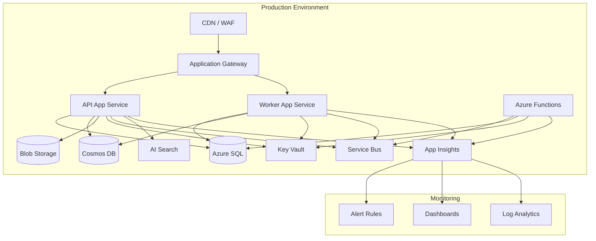
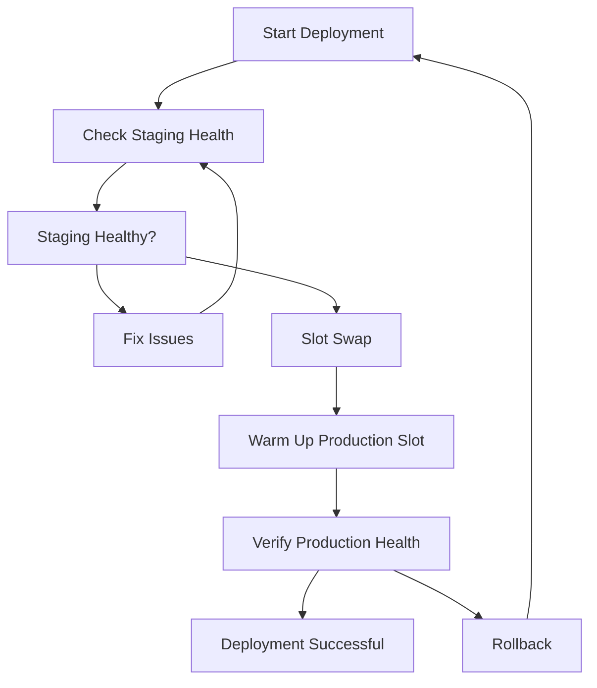
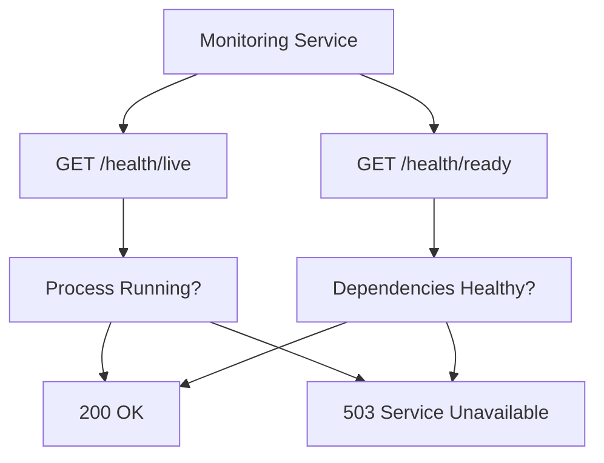
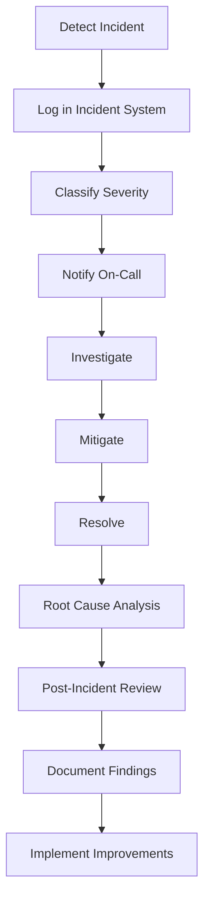

# Operations Runbook

## Overview

This runbook provides operational procedures for common tasks and incidents in the LeaseCore platform.

## System Architecture

## Common Operational Procedures

### 1. Application Deployment

#### Pre-Deployment Checklist

- [ ] Run automated tests (unit, integration, contract)
- [ ] Run security scans (SAST, DAST, dependency)
- [ ] Review and approve pull requests
- [ ] Create release notes
- [ ] Notify stakeholders of scheduled deployment
- [ ] Backup production database (if schema changes)
- [ ] Verify staging environment is healthy

#### Deployment Process

**Steps:**

1. Deploy to staging slot
2. Run smoke tests on staging
3. Perform slot swap to production
4. Monitor health checks
5. Verify functionality
6. Monitor for errors

**Rollback Procedure:**

If deployment fails:
1. Immediate slot swap back to previous slot
2. Investigate failure in staging
3. Fix issues
4. Redeploy

### 2. Database Maintenance

#### Database Backup Verification

**Frequency:** Weekly

**Procedure:**

1. Navigate to Azure SQL Database
2. Check automated backups
3. Verify backup retention (7-35 days)
4. Test restore to test database quarterly
5. Document restore results

#### Database Index Maintenance

**Frequency:** Monthly

**Procedure:**

1. Identify fragmented indexes
2. Rebuild indexes with fragmentation > 30%
3. Reorganize indexes with fragmentation 10-30%
4. Update statistics
5. Monitor query performance

#### Schema Migration

**Procedure:**

1. Test migration on staging database
2. Backup production database
3. Apply migration during maintenance window
4. Verify data integrity
5. Monitor application performance
6. Rollback plan ready if issues detected

### 3. Monitoring & Alerting

#### Health Check Endpoints

**Health Check Monitoring:**

- Liveness: Process is running
- Readiness: Database, external services accessible
- Interval: 30 seconds
- Timeout: 5 seconds
- Failure threshold: 3 consecutive failures

#### Key Metrics to Monitor

| Metric | Threshold | Alert Level |
|--------|-----------|-------------|
| CPU Usage | > 80% | Warning |
| CPU Usage | > 95% | Critical |
| Memory Usage | > 85% | Warning |
| Memory Usage | > 95% | Critical |
| Response Time | > 500ms | Warning |
| Response Time | > 2s | Critical |
| Error Rate | > 1% | Warning |
| Error Rate | > 5% | Critical |
| Database Connections | > 80% | Warning |
| Database Connections | > 95% | Critical |

### 4. Log Management

#### Log Retention

| Log Type | Retention Period | Storage |
|----------|------------------|---------|
| Application Logs | 90 days | Log Analytics |
| Audit Logs | 7 years | Blob Storage |
| Security Logs | 7 years | Blob Storage |
| Access Logs | 1 year | Blob Storage |
| Performance Logs | 90 days | Log Analytics |

#### Log Investigation Procedure

1. Identify time range of incident
2. Query Application Insights for errors
3. Filter by tenant ID if tenant-specific
4. Check correlation IDs across services
5. Review dependency calls
5. Analyze exceptions and stack traces

### 5. Incident Response

#### Incident Severity Levels

| Severity | Definition | Response Time |
|----------|------------|---------------|
| P0 - Critical | System down, data loss, security breach | 15 minutes |
| P1 - High | Major functionality unavailable | 1 hour |
| P2 - Medium | Partial functionality unavailable | 4 hours |
| P3 - Low | Minor issues, workarounds available | 24 hours |

#### Incident Response Process

**P0 Incident Response (Service Outage):**

1. **Immediate (0-15 min):**
   - Acknowledge alert
   - Assess impact
   - Notify stakeholders
   - Begin investigation

2. **Investigation (15-60 min):**
   - Check health endpoints
   - Review recent deployments
   - Check error logs
   - Identify root cause

3. **Mitigation (60-120 min):**
   - Implement temporary fix
   - Rollback if necessary
   - Restore service
   - Verify functionality

4. **Recovery (120+ min):**
   - Monitor for recurrence
   - Document incident
   - Schedule post-mortem
   - Implement permanent fix

### 6. Common Incidents

#### High CPU Usage

**Symptoms:**
- Slow response times
- CPU usage > 80%
- Timeouts

**Investigation:**
1. Check App Service metrics
2. Identify high CPU processes
3. Review recent code changes
4. Check for inefficient queries

**Mitigation:**
1. Scale out (add instances)
2. Scale up (larger instance size)
3. Optimize slow queries
4. Implement caching

#### Database Connection Pool Exhaustion

**Symptoms:**
- Database connection errors
- Slow database queries
- Timeouts

**Investigation:**
1. Check connection pool metrics
2. Identify connection leaks
3. Review query performance
4. Check for long-running transactions

**Mitigation:**
1. Increase connection pool size
2. Fix connection leaks in code
3. Optimize queries
4. Add database read replicas

#### Outbox Message Backlog

**Symptoms:**
- Event processing delays
- Outbox table growth
- Integration failures

**Investigation:**
1. Check outbox message count
2. Review failed messages
3. Check external service status
4. Review worker logs

**Mitigation:**
1. Scale out worker service
2. Fix failed message processing
3. Restart external services
4. Manual message retry

#### Rate Limit Breaches

**Symptoms:**
- 429 responses
- API abuse detection
- Performance degradation

**Investigation:**
1. Identify offending tenant/user
2. Review request patterns
3. Check for automated attacks
4. Review rate limit configuration

**Mitigation:**
1. Block malicious IPs
2. Adjust rate limits
3. Contact tenant if legitimate
4. Implement CAPTCHA if needed

### 7. Scheduled Maintenance

#### Maintenance Windows

| Environment | Window | Frequency |
|-------------|--------|-----------|
| Production | Sunday 2:00-4:00 AM UTC | Monthly |
| Staging | Saturday 8:00-10:00 AM UTC | Weekly |
| Development | As needed | As needed |

#### Maintenance Procedure

1. **Pre-Maintenance (1 week before):**
   - Schedule maintenance window
   - Notify all stakeholders
   - Update status page
   - Prepare rollback plan

2. **During Maintenance:**
   - Put application in maintenance mode
   - Perform maintenance tasks
   - Verify system health
   - Take application out of maintenance mode

3. **Post-Maintenance:**
   - Monitor system for 24 hours
   - Update status page
   - Document changes
   - Review with team

### 8. Disaster Recovery

#### Recovery Time Objectives (RTO)

| Service | RTO | RPO |
|---------|-----|-----|
| API Services | 1 hour | 15 minutes |
| Database | 4 hours | 15 minutes |
| Documents | 4 hours | 1 hour |
| Configuration | 1 hour | 0 |

#### Disaster Recovery Test

**Frequency:** Quarterly

**Procedure:**

1. Trigger failover to secondary region
2. Verify DNS propagation
3. Test critical functionality
4. Monitor performance
5. Failback to primary region
6. Document results

#### Site Recovery Procedure

1. Declare disaster
2. Activate DR plan
3. Failover to secondary region
4. Verify data integrity
5. Restore from backups if needed
6. Update DNS
7. Monitor systems
8. Communicate with stakeholders

### 9. Performance Tuning

#### Query Optimization

**Procedure:**

1. Identify slow queries via Query Store
2. Analyze execution plans
3. Add or update indexes
4. Rewrite queries if needed
5. Test improvements
6. Monitor performance

#### Caching Strategy

**Cache Layers:**

1. **Application Cache (In-Memory):**
   - frequently accessed reference data
   - TTL: 5-15 minutes

2. **Redis Cache (Distributed):**
   - session data
   - user preferences
   - rate limit counters
   - TTL: 30-60 minutes

3. **CDN Cache:**
   - static assets
   - API responses (where appropriate)
   - TTL: 1-24 hours

### 10. Security Operations

#### Security Incident Response

**Procedure:**

1. **Contain:**
   - Isolate affected systems
   - Block malicious IPs
   - Revoke compromised credentials

2. **Eradicate:**
   - Remove malware
   - Patch vulnerabilities
   - Close security gaps

3. **Recover:**
   - Restore from clean backups
   - Reset credentials
   - Verify system integrity

4. **Post-Incident:**
   - Document incident
   - Conduct root cause analysis
   - Implement improvements
   - Notify regulatory bodies if required

#### Access Review

**Frequency:** Quarterly

**Procedure:**

1. Export user access list
2. Review with department heads
3. Remove unnecessary access
4. Document changes
5. Update access policies

## Contact Information

| Role | Contact | On-Call |
|------|---------|---------|
| Incident Commander | incident-commander@leasecore.com | Yes |
| Security Engineer | security@leasecore.com | Yes |
| DevOps Engineer | devops@leasecore.com | Yes |
| Database Administrator | dba@leasecore.com | No |
| Legal/Compliance | legal@leasecore.com | No |

## External Services

| Service | Support Contact | SLA |
|---------|----------------|-----|
| Azure Support | Azure Portal | 99.9% |
| Entra ID | Microsoft Support | 99.9% |
| Third-party APIs | Vendor Support | Variable |
