# Security Controls

## Overview

This document details the security controls implemented in the LeaseCore platform to protect against identified threats.

## Authentication Controls

### Multi-Factor Authentication (MFA)

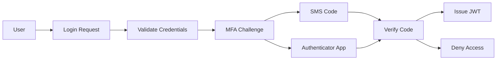

**Implementation:**
- Entra ID MFA required for all users
- Conditional access policies based on location, device, risk
- Backup authentication methods (phone, email)

### JWT Token Management

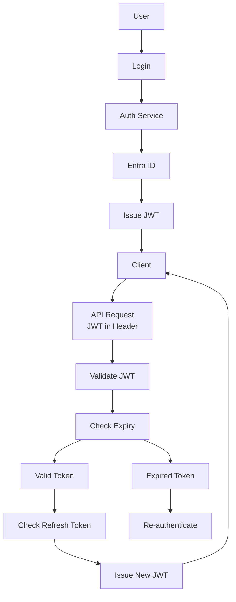

**Token Configuration:**
- Access token lifetime: 15 minutes
- Refresh token lifetime: 7 days
- Refresh token rotation on use
- Token revocation on logout

## Authorization Controls

### Role-Based Access Control (RBAC)

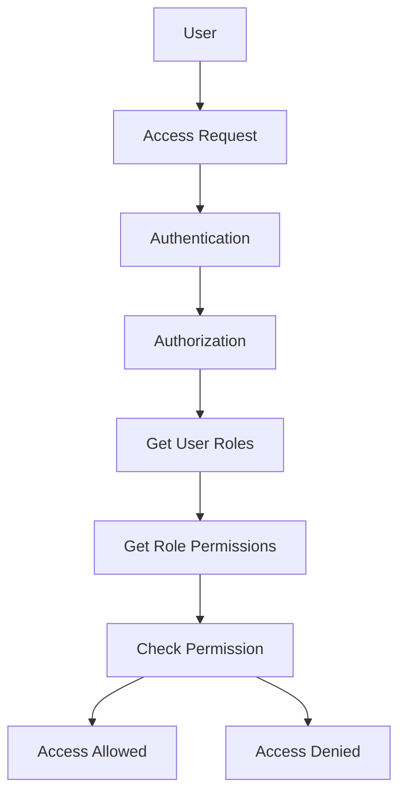

**Implementation:**
- Roles defined per tenant
- Permissions assigned to roles
- Users assigned to roles within organizations
- Resource-level authorization where applicable

### Tenant Isolation

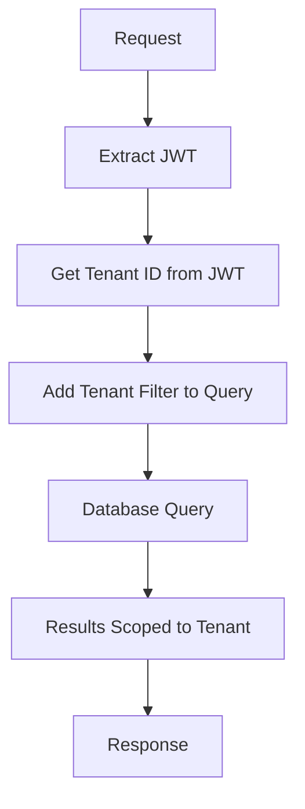

**Implementation:**
- Tenant ID derived from JWT, not request
- Global query filters in EF Core
- Row-level security in SQL Server
- Partition key in Cosmos DB

## Data Protection Controls

### Encryption at Rest

| Data Store | Encryption Method | Key Management |
|------------|------------------|----------------|
| SQL Server | Transparent Data Encryption (TDE) | Azure Key Vault |
| Cosmos DB | Service-managed encryption | Azure Key Vault |
| Blob Storage | Microsoft-managed encryption | Azure Key Vault |
| Disk | Azure Disk Encryption | Azure Key Vault |

### Encryption in Transit

- TLS 1.3 for all external communications
- TLS 1.2 minimum for internal communications
- Certificate pinning for external services
- Regular certificate rotation

### Data Masking

- Mask sensitive data in logs (PII, financial data)
- Mask sensitive data in error messages
- Dynamic data masking in SQL Server for privileged users

## API Security Controls

### Rate Limiting

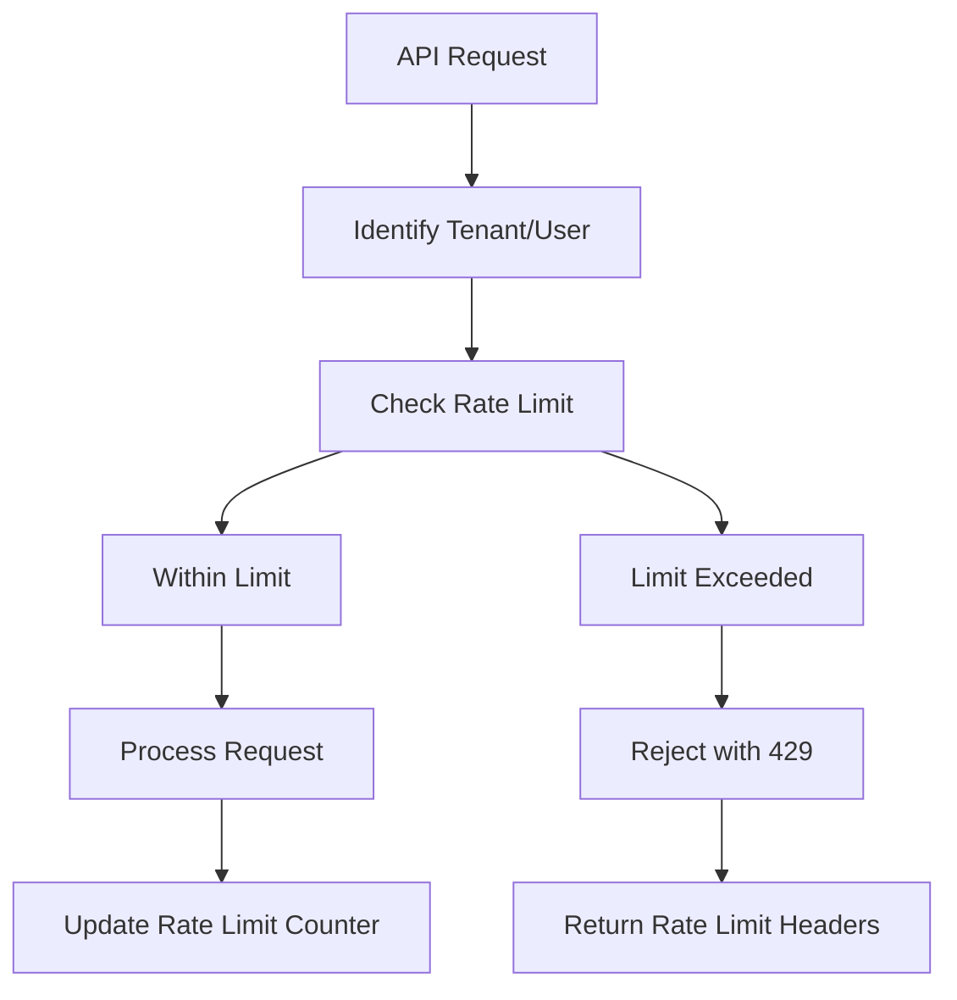

**Configuration:**
- 1000 requests per minute per tenant
- 100 requests per second burst
- Sliding window algorithm
- Redis-backed distributed counter

### GraphQL Security

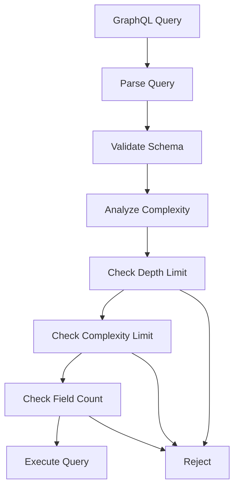

**Limits:**
- Maximum query depth: 10
- Maximum complexity: 1000
- Maximum field count: 100
- Query timeout: 30 seconds

### Input Validation

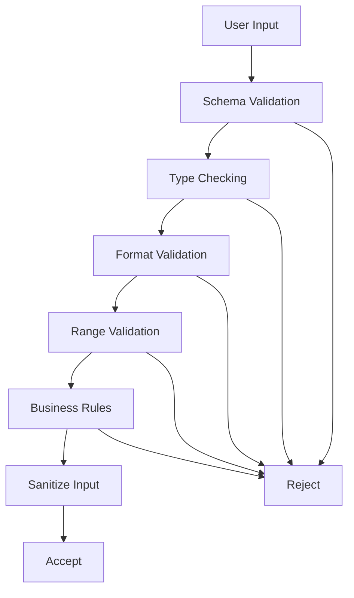

**Implementation:**
- FluentValidation for all DTOs
- Regular expression for format validation
- Range checks for numeric values
- Custom business rule validators

## Document Security Controls

### File Upload Validation

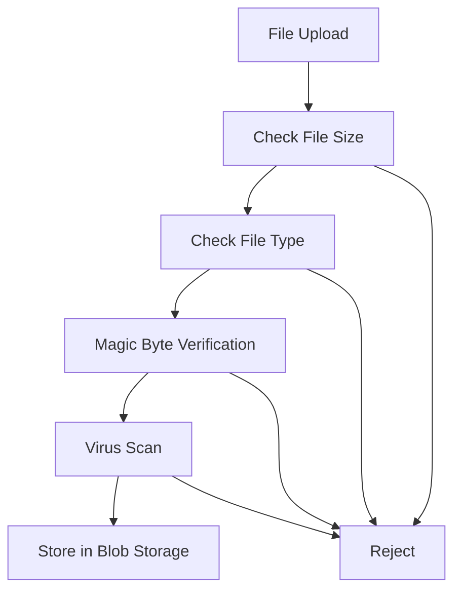

**Validation Rules:**
- Maximum file size: 50 MB
- Allowed MIME types: PDF, DOCX, XLSX, JPG, PNG
- Magic byte verification
- Virus scanning with Microsoft Defender

### Document Access Control

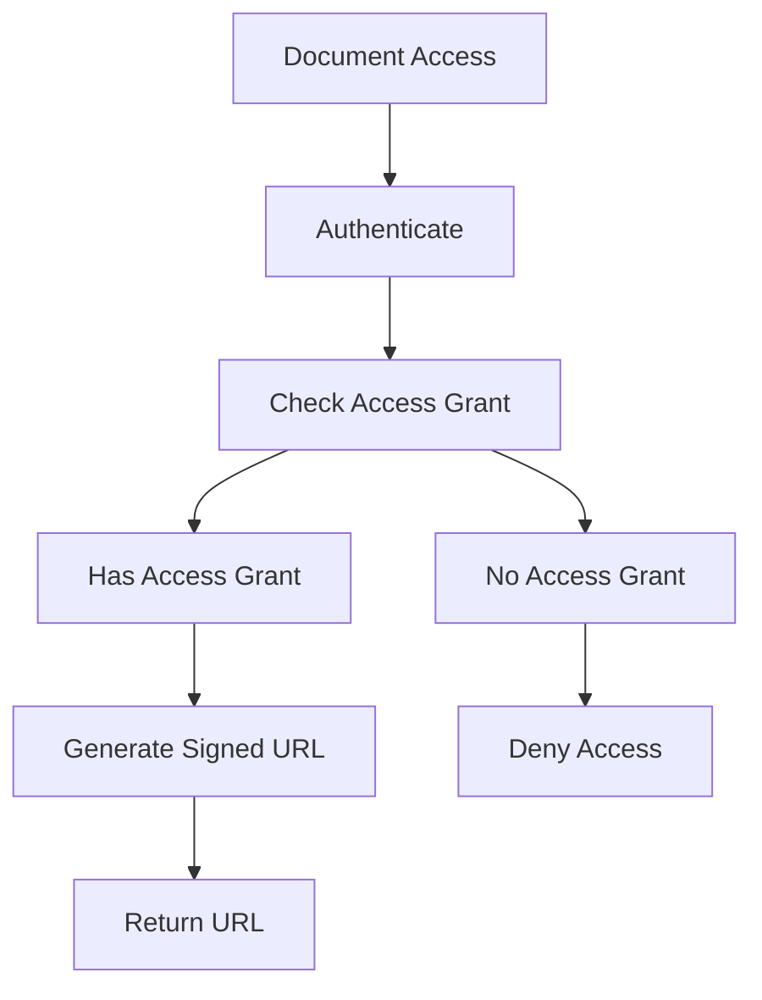

**Implementation:**
- Document access grants stored in database
- Signed URLs with SAS tokens
- URL expiration: 15 minutes
- Access logging

## Infrastructure Security Controls

### Key Management

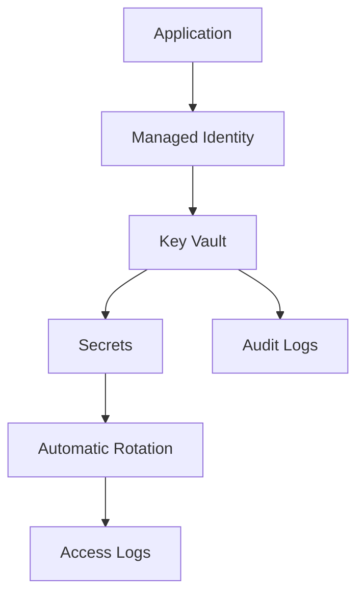

**Implementation:**
- Azure Key Vault for all secrets
- Managed identities for Azure resources
- Automatic key rotation (90 days)
- Audit logging for all key access

### Network Security

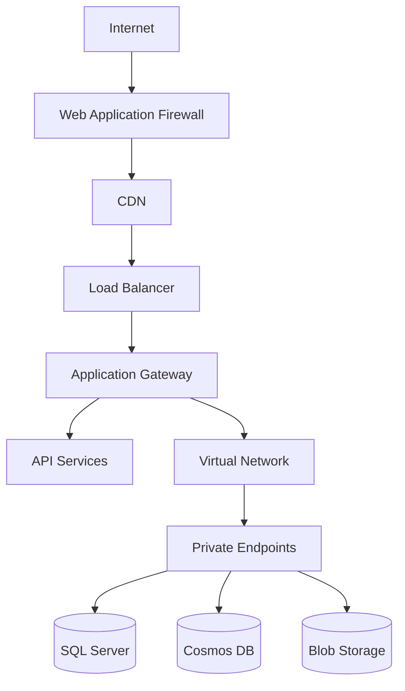

**Implementation:**
- Azure WAF with OWASP rules
- DDoS protection
- Virtual Network isolation
- Private endpoints for Azure services
- Network security groups (NSGs)

## Monitoring & Logging Controls

### Logging Strategy

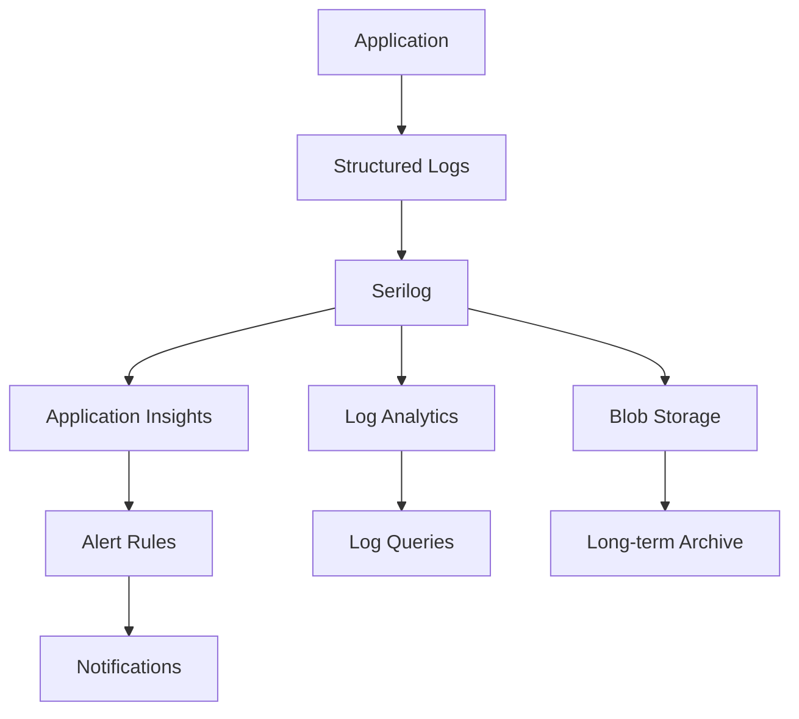

**Log Types:**
- Security events (login, authorization failures)
- Audit events (data changes, permission changes)
- Performance metrics
- Error logs
- Access logs

### Alerting

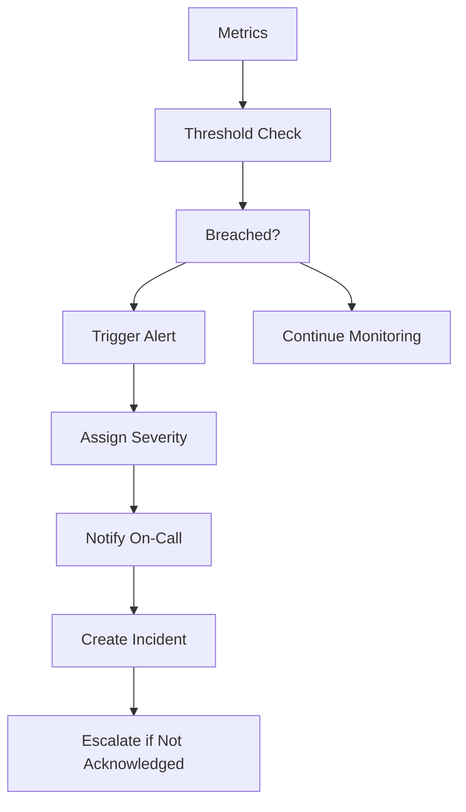

**Alert Types:**
- Failed authentication attempts (> 10/min)
- Authorization failures (> 50/min)
- Unusual data access patterns
- API rate limit breaches
- Database connection failures
- Application errors (> 5/min)

## Compliance Controls

### GDPR Compliance

| Requirement | Control |
|-------------|---------|
| Data protection by design | Privacy by design principles in architecture |
| Right to be forgotten | Data deletion workflows |
| Data portability | Export functionality |
| Breach notification | Automated breach detection and notification |
| Consent management | Cookie consent, data processing consent |

### SOC 2 Compliance

| Trust Principle | Control |
|-----------------|---------|
| Security | Access controls, encryption, monitoring |
| Availability | High availability architecture, backups |
| Processing integrity | Change management, audit logging |
| Confidentiality | Data classification, access controls |
| Privacy | Data minimization, consent management |

## Security Testing

### Regular Security Activities

- **Weekly**: Automated dependency vulnerability scanning
- **Monthly**: Security log review, access review
- **Quarterly**: Penetration testing, security architecture review
- **Annually**: Full security audit, compliance audit

### Security Testing Tools

- **SAST**: SonarQube, GitHub Advanced Security
- **DAST**: OWASP ZAP, Burp Suite
- **Dependency Scanning**: Dependabot, Snyk
- **Container Scanning**: Trivy, Azure Container Scan
- **Infrastructure Scanning**: Azure Security Center

## Incident Response

### Incident Response Process

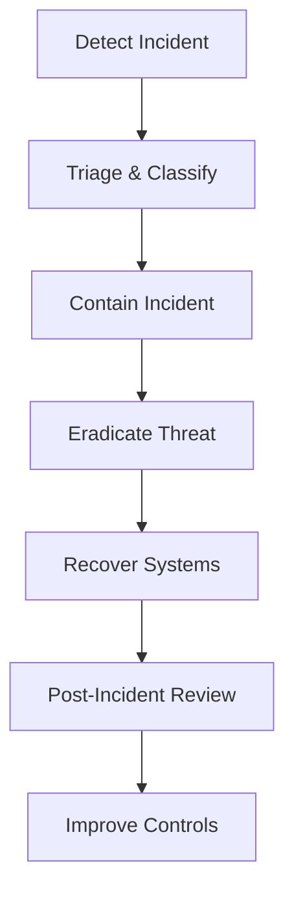

### Incident Response Team

- **Incident Commander**: Overall coordination
- **Security Engineer**: Technical investigation
- **DevOps Engineer**: System recovery
- **Legal/Compliance**: Regulatory requirements
- **Communications**: Stakeholder communication

### Incident Categories

| Category | Severity | Response Time |
|----------|----------|---------------|
| Critical | P0 | 15 minutes |
| High | P1 | 1 hour |
| Medium | P2 | 4 hours |
| Low | P3 | 24 hours |

## Security Best Practices

### Development

- Code reviews required for all changes
- Security training for all developers
- Secure coding guidelines
- Regular security testing in CI/CD

### Operations

- Least privilege access for operations
- Separate admin accounts
- Regular access reviews
- Secure secrets management

### Architecture

- Defense in depth
- Zero trust architecture
- Secure by design
- Regular threat modeling
