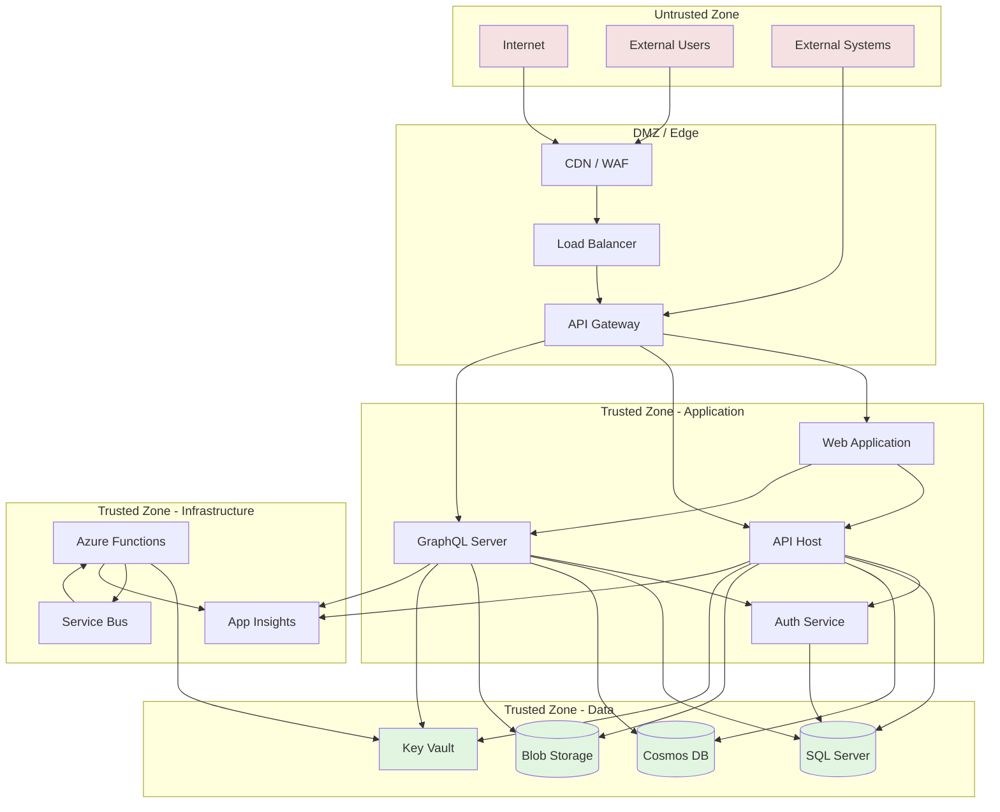

# Threat Model

## Threat Model Overview

This document outlines the threat model for the LeaseCore platform, identifying potential threats, attack vectors, and mitigation strategies.

## Trust Boundaries

## Identified Threats

### 1. Authentication & Authorization Threats

#### Threat: Credential Theft
- **Description**: Attacker steals user credentials via phishing, keylogging, or data breaches
- **Impact**: Unauthorized access to user accounts and tenant data
- **Mitigation**:
  - Multi-factor authentication (MFA) required
  - Entra ID with conditional access policies
  - Regular password rotation policies
  - Monitor for suspicious login patterns

#### Threat: Privilege Escalation
- **Description**: Attacker gains higher privileges than intended
- **Impact**: Unauthorized access to sensitive data or administrative functions
- **Mitigation**:
  - Principle of least privilege
  - Role-based access control (RBAC)
  - Regular permission audits
  - Separate admin accounts from user accounts

#### Threat: JWT Token Theft
- **Description**: Attacker steals JWT tokens via XSS or network interception
- **Impact**: Session hijacking and unauthorized access
- **Mitigation**:
  - Short token expiration (15-30 minutes)
  - Refresh tokens with secure storage
  - HttpOnly, Secure, SameSite cookies
  - Token revocation on logout

### 2. Data Protection Threats

#### Threat: Data Exfiltration
- **Description**: Attacker extracts sensitive data from the system
- **Impact**: Data breach, regulatory fines, reputational damage
- **Mitigation**:
  - Tenant isolation at database level
  - Data encryption at rest (SQL TDE, Cosmos encryption)
  - Data encryption in transit (TLS 1.3)
  - Data loss prevention (DLP) policies
  - Audit logging for data access

#### Threat: SQL Injection
- **Description**: Attacker injects malicious SQL via input fields
- **Impact**: Data theft, data corruption, database compromise
- **Mitigation**:
  - Parameterized queries (EF Core)
  - Input validation and sanitization
  - Least privilege database accounts
  - Regular security testing

#### Threat: NoSQL Injection
- **Description**: Attacker injects malicious queries to Cosmos DB
- **Impact**: Data theft, unauthorized data modification
- **Mitigation**:
  - Parameterized queries
  - Input validation
  - Least privilege Cosmos accounts
  - Request unit monitoring

### 3. API Security Threats

#### Threat: API Abuse / Rate Limiting Bypass
- **Description**: Attacker overwhelms API with excessive requests
- **Impact**: Denial of service, increased costs
- **Mitigation**:
  - Rate limiting per tenant and per user
  - API throttling
  - Request queuing
  - DDOS protection via Azure WAF

#### Threat: GraphQL Query Depth Attack
- **Description**: Attacker crafts deeply nested GraphQL queries
- **Impact**: Resource exhaustion, denial of service
- **Mitigation**:
  - Query depth limits (max 10 levels)
  - Query complexity limits
  - Field count limits
  - Query timeout

#### Threat: GraphQL Introspection Abuse
- **Description**: Attacker uses introspection to discover schema
- **Impact**: Information disclosure, attack surface analysis
- **Mitigation**:
  - Disable introspection in production
  - Schema whitelisting
  - Document schema separately

### 4. Document Security Threats

#### Threat: Malicious File Upload
- **Description**: Attacker uploads malicious files (viruses, malware)
- **Impact**: System compromise, data theft
- **Mitigation**:
  - File type validation (MIME type + magic bytes)
  - File size limits
  - Virus scanning integration
  - Sandbox for file processing

#### Threat: Unauthorized Document Access
- **Description**: Attacker accesses documents without permission
- **Impact**: Data breach, confidentiality violation
- **Mitigation**:
  - Document access grants
  - Signed URLs with expiration
  - Access logging
  - Regular access audits

### 5. Cross-Tenant Threats

#### Threat: Cross-Tenant Data Access
- **Description**: Attacker accesses data from another tenant
- **Impact**: Data breach, multi-tenant isolation failure
- **Mitigation**:
  - Tenant ID in all database queries
  - Row-level security (RLS)
  - Tenant-scoped query filters
  - Regular tenant isolation testing

#### Threat: Tenant ID Spoofing
- **Description**: Attacker spoofs tenant ID in requests
- **Impact**: Unauthorized cross-tenant access
- **Mitigation**:
  - Derive tenant ID from JWT, not request
  - Validate tenant membership server-side
  - Never trust client-supplied tenant IDs

### 6. Supply Chain Threats

#### Threat: Dependency Vulnerabilities
- **Description**: Vulnerabilities in NuGet packages or npm dependencies
- **Impact**: System compromise, data breach
- **Mitigation**:
  - Dependency scanning (Dependabot, Snyk)
  - Regular dependency updates
  - Vendor risk assessment
  - SBOM (Software Bill of Materials)

#### Threat: CI/CD Pipeline Compromise
- **Description**: Attacker compromises build or deployment pipeline
- **Impact**: Malicious code deployment, supply chain attack
- **Mitigation**:
  - Pipeline security best practices
  - Code reviews required
  - Branch protection rules
  - Signed artifacts

### 7. Infrastructure Threats

#### Threat: Key Theft
- **Description**: Attacker steals API keys, connection strings, or certificates
- **Impact**: Full system compromise
- **Mitigation**:
  - Azure Key Vault for secrets
  - Managed identities for Azure resources
  - No secrets in code or config
  - Regular key rotation

#### Threat: Insider Threat
- **Description**: Authorized user abuses access for malicious purposes
- **Impact**: Data theft, data corruption, sabotage
- **Mitigation**:
  - Principle of least privilege
  - Separation of duties
  - Audit logging for all actions
  - Regular access reviews

## Threat Mitigation Matrix

| Threat | Likelihood | Impact | Mitigation Priority |
|--------|------------|--------|---------------------|
| Credential Theft | Medium | High | High |
| Privilege Escalation | Low | High | High |
| JWT Token Theft | Medium | High | High |
| Data Exfiltration | Low | High | High |
| SQL Injection | Low | High | High |
| NoSQL Injection | Low | High | High |
| API Abuse | High | Medium | Medium |
| GraphQL Depth Attack | Medium | Medium | Medium |
| Malicious File Upload | Medium | Medium | Medium |
| Unauthorized Document Access | Low | High | High |
| Cross-Tenant Data Access | Low | High | High |
| Dependency Vulnerabilities | Medium | Medium | Medium |
| Key Theft | Low | High | High |
| Insider Threat | Low | High | Medium |

## Security Controls

### Preventive Controls

1. **Authentication**
   - Entra ID with MFA
   - Conditional access policies
   - JWT with short expiration

2. **Authorization**
   - RBAC with least privilege
   - Resource-based authorization
   - Tenant isolation

3. **Input Validation**
   - FluentValidation for all inputs
   - Parameterized queries
   - File type validation

4. **Encryption**
   - TLS 1.3 for data in transit
   - Azure encryption for data at rest
   - Key Vault for key management

5. **API Security**
   - Rate limiting
   - GraphQL query limits
   - API gateway protection

### Detective Controls

1. **Logging**
   - Structured logging (Serilog)
   - Audit logging for sensitive operations
   - Log aggregation

2. **Monitoring**
   - Application Insights
   - Custom alerts for suspicious activity
   - Performance monitoring

3. **Threat Detection**
   - Azure Security Center
   - Anomaly detection
   - SIEM integration

### Corrective Controls

1. **Incident Response**
   - Documented incident response plan
   - On-call rotation
   - Escalation procedures

2. **Backup & Recovery**
   - Regular database backups
   - Point-in-time restore
   - Disaster recovery procedures

3. **Patch Management**
   - Regular security updates
   - Vulnerability scanning
   - Patch deployment procedures

## Compliance Considerations

### GDPR
- Data protection by design
- Right to be forgotten
- Data portability
- Breach notification within 72 hours

### SOC 2
- Access controls
- Change management
- Incident response
- Vulnerability management

### IFRS 16
- Audit trail for accounting entries
- Data integrity
- Retention policies

## Regular Security Activities

- Quarterly penetration testing
- Monthly dependency vulnerability scans
- Weekly security log reviews
- Annual security audit
- Regular security training for developers
